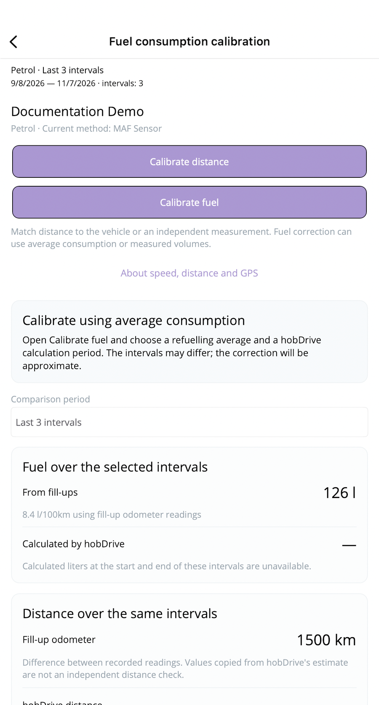
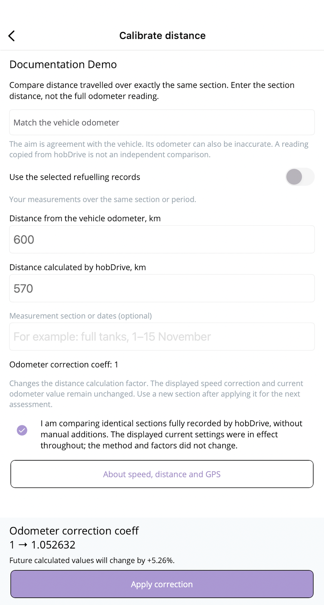
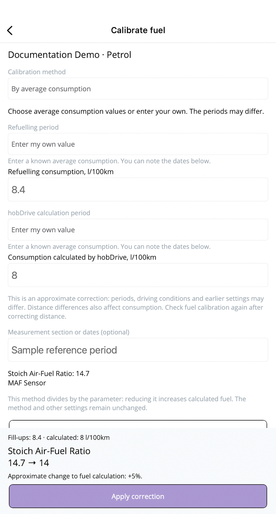

[User's Manual](user-manual.md#calibration-and-calculation-accuracy) | [Index](../README.md) | [Русский](../ru/calibration.md)

# Distance and Fuel Consumption Calibration

Calibration helps bring hobDrive's calculations into line with verified distance and fuel measurements. The app shows the source data, proposes a correction, and keeps a record of applied changes. Start with distance: an error in distance also affects consumption in L/100 km.

The screenshots use sample data in the English Mac Catalyst app. Controls may be arranged differently on a phone.

## Contents
{:.no_toc}
* TOC
{:toc}

## Open calibration

In the classic interface, choose **Actions → Fuel consumption calibration**. In the [Control center](control-center.md), open **Frequent actions**, expand **All** if needed, and choose **Calibration**. The full action name is **Fuel consumption calibration**, but the screen handles both fuel and distance.

**Tank and remaining fuel** is a separate action. It sets the tank capacity and initial amount of fuel already consumed, which are used to estimate the fuel remaining in the tank.

{: width="400" }

*Choose whether to check distance or fuel use first.*

## Prepare your measurements

1. Check the vehicle profile, fuel calculation method, and units.
2. To check distance, record the vehicle odometer at the start and end of a section, or obtain an independent distance measurement. hobDrive must record the entire same section.
3. For a comparison based on fill-ups, mark each full tank as **Full tank** and record every fill-up in between, including partial ones. Enter the actual odometer reading from the vehicle.
4. When comparing matching sections, use measurements collected with the same calculation method and correction factors throughout. Missing trips and manual additions can distort the result.

If you accept hobDrive's suggested odometer reading at a fill-up, comparing against that reading is not an independent distance check.

## Read the calibration overview

For a dual-fuel profile, select the fuel first. Then choose **Last complete interval**, **Last 3 intervals**, **Last 90 days**, or **All complete intervals**.

Each complete interval starts and ends with a full tank. The amount added at the starting fill-up is excluded; every subsequent fill-up, including the final full tank, is included. For example, a partial fill-up of 20 L followed by a final full fill-up of 40 L, over 600 km, means 60 L consumed and 10 L/100 km.

Tap **View intervals** to see the dates, fuel volumes, and odometer readings. If a record needs correcting, open **Fueling history**, edit it, and return: the results will refresh. The current unfinished interval is excluded from the comparison.

A dash beside **Calculated by hobDrive**, **hobDrive distance**, or **GPS distance** means there are no comparable historical measurements. The app does not reconstruct them from today's settings. You can enter your own measurements separately when calculating a correction.

## Calibrate distance

1. Tap **Calibrate distance**.
2. Choose **Match the vehicle odometer** or **Independent distance / GPS**.
3. Enter the distance covered according to the reference and according to hobDrive over the same section. Enter the distance traveled, such as 600 km, rather than an absolute odometer reading such as 124,600 km.
4. If you use the selected fill-up records, compare only the complete intervals shown. Gaps between them may have been excluded.
5. Review the proposal at the bottom, confirm that the measurements are comparable, and tap **Apply correction**. You can go back before applying it without changing the factor.

{: width="400" }

*In this example, the distance factor changes from 1 to 1.052632. The proposal stays visible as you scroll.*

This changes the distance calculation factor. It leaves the separate speed correction and current absolute odometer value unchanged. For GPS, enter a distance from a track you have checked yourself: hobDrive does not yet maintain a separate automatic GPS-distance total for calibration.

For reference selection and the formula, see [Speed and distance](speed-diff.md).

## Calibrate fuel

Tap **Calibrate fuel**. In a dual-fuel profile, calibrate each fuel separately.

### By average consumption

This is the default method. For the fill-up reference, choose **All fill-ups (journal)**, a period based on completed full-tank intervals, or your own value. For hobDrive, choose a week, month, all time, current tank, Trip A/B, or enter a value yourself.

Check both the periods and the values. If the periods differ, the correction is approximate: driving conditions and distance differences may affect the comparison. For example, 8.4 L/100 km from fill-ups and 8.0 L/100 km from hobDrive produce a proposal to increase future calculated fuel use by 5%.

{: width="400" }

*The app selects the parameter for the current method. With MAF, reducing AFR increases calculated fuel use.*

**All fill-ups (journal)** matches the journal's **Cumulative** value. **All full-tank intervals** is a separate reference based on explicit full-tank marks, so the values can differ. If the journal combines two fuels, use the selected fuel's full-tank intervals or your own measurement to calibrate that fuel.

### By fuel volume

Choose **By fuel volume** when you have actual fuel consumed and hobDrive's calculated fuel volume for **identical intervals**. You can take the actual amount from the selected full-tank intervals; enter hobDrive's calculated amount for exactly the same sections. Confirm that recording was complete and the settings did not change.

This checks fuel use separately from distance differences. Do not compare calculated fuel for one month with fill-ups from another period. Two arbitrary partial fill-ups do not establish the fuel consumed either.

For either method, check the old and proposed values, then tap **Apply correction**. Decimal points and commas are accepted. For the formulas used by each method, see [Fuel calculation methods and calibration](fuel-methods.md).

## After applying a correction

A correction affects subsequent measurements. Accumulated fuel, distance, and earlier averages are not recalculated. Check the result over a new, fully recorded section.

At the bottom of the overview, **Recent corrections** shows the last five applications, including the date, source measurements, and parameter changed. This is the history of calibration actions; changes made elsewhere in vehicle settings are not yet tracked here.

If the form says new measurements are needed, choose a later period or enter a new measurement collected with the current settings. An average containing data from before the previous correction, or measurements already used for a correction, cannot be used again. If the correction is saved but the app asks you to restart, restart hobDrive before collecting new measurements.

## If the result is unexpected

Check units, dates, full-tank marks, and missing fill-ups or trips. A correction factor cannot restore missing data. After changing tire size, the speed source, or the fuel calculation method, collect a new reference section.

For dual-fuel vehicles, compare values with the same meaning: this screen relates the selected fuel's volume to the vehicle's total distance. Hourly fuel use at idle can reveal a major method error, but it does not replace a measurement based on fill-ups.

Related: [Trips and expenses](trips-and-expenses.md), [Fuel consumption readings](user-manual.md#fuel-consumption-details), [Tank and remaining fuel in the manual](user-manual.md#fuel-details).
