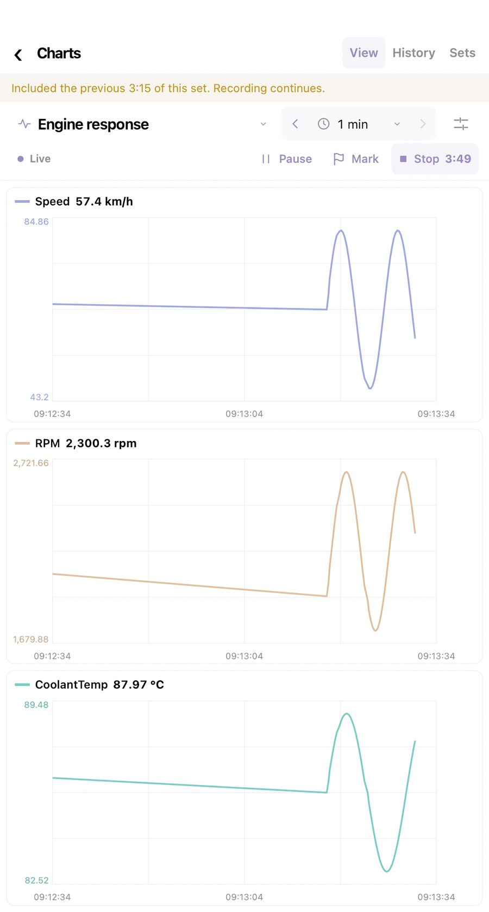
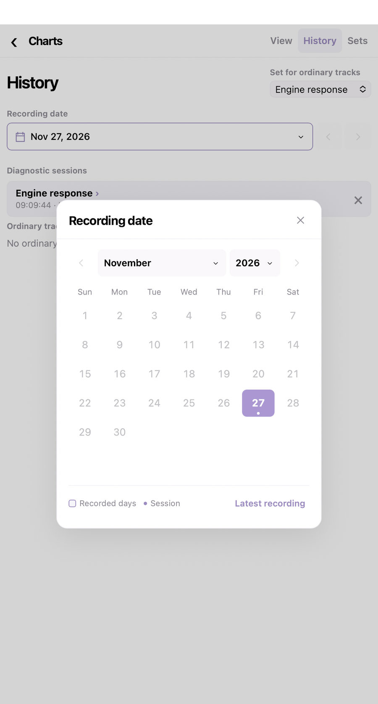
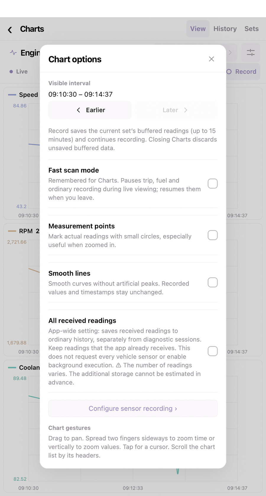

[User's Manual](user-manual.md#sensor-charts) | [Index](../README.md) | [Русский](../ru/charts.md)

# Sensor Charts

**Charts** displays several sensors on a shared timeline. You can watch live readings, pause the view, inspect saved history, and, in the full version, record a diagnostic session with markers. For example, you can compare RPM and throttle position without switching between gauge screens.

This tool is for sensor readings. Charts of spending and fill-ups are covered in [Trip Statistics and Online Analytics](statistics.md).

The screenshots show the English Mac Catalyst app with test signals. The curves do not illustrate a vehicle fault diagnosis.

## Contents
{:.no_toc}
* TOC
{:toc}

## Open Charts and choose a set

In the classic interface, choose **Screens → Charts** or **Actions → Charts**. In the [Control center](control-center.md), choose **Charts**; expand **All** if it is not among the frequent actions.

Open **Sets** and choose a preset, such as **Engine response** or **Fuel trims**. Tap **Open** to use it. Available readings depend on the current ECU profile and connection.

The demo version allows up to three sensors per set; the full version allows up to 32. If a larger set was saved earlier, the demo shows its first three sensors and preserves the full set.

{: width="400" }

*Signals in a set can share a chart or have separate charts. Time controls, pause, and recording are available at the top.*

## View live readings

On the **View** tab, **Live** follows incoming readings. Choose a **Time window** suited to a short response or a longer section.

- **Pause** stops following the current time so you can inspect a section. **Resume live** returns to incoming readings.
- Drag a chart to move along the timeline. Spread two fingers horizontally to change the time scale or vertically to change the value scale.
- Tap to place a cursor. Labels show the nearest actual measurement; **Clear cursor** removes it.
- If there are many charts, scroll the list by dragging their headers. **Auto Y** restores the automatic value scale.

In **Chart options**, you can enable **Measurement points** and **Smooth lines**. Points show when readings actually arrived. Smoothing changes the line between measurements while preserving recorded values and timestamps. A large gap is shown as a break, rather than as continuous data.

## Create your own set

1. Open **Sets → New set**. For a preset, choose **Edit a copy** to preserve the original.
2. Enter a name and tap **Add sensor**. Find a sensor by name or ID.
3. Put signals on the same chart to compare them, or choose **Separate chart**. You can set the line color, width, and style: **Solid**, **Dashed**, **Points**, or **Filled area**.
4. Tap **Save**, then **Open**. **Cancel** leaves the previous set unchanged.

If a sensor is **Unavailable**, check the ECU profile and whether the vehicle supports that parameter. **Waiting for readings** and **No recent sample** do not mean the sensor is reading zero.

## Record a diagnostic session

Session recording is available in the full version.

1. Go live and choose a set with available sensors.
2. Tap **Record session**, or **Record** on a compact screen.
3. Tap **Mark** when you want to identify a moment of interest.
4. Tap **Stop**, then open the result in **History**.

The session includes the available buffered readings for the current set from before you pressed Record, up to 15 minutes, and then continues recording. This helps capture a moment that has just happened while Charts was open. Closing Charts discards the unsaved buffer; it is not a substitute for ongoing recording.

When viewing a session, **Jump to marker** returns to a marked event. If recording is interrupted, check the session in History and the device's free storage space.

## Open history

Go to **History**. The calendar highlights days with data. Choose a day, then a diagnostic session or an interval of ordinary track recordings. The arrows move between recorded days.

{: width="400" }

For ordinary tracks, the selected set matters: past readings are available only for sensors that were actually recorded. Use **Choose sensors with history** or **Only sensors with history** if the current set has no suitable data. Selecting a sensor today does not create readings for an earlier trip.

**Delete from device** removes a session's local copy. If it has already been uploaded, its cloud copy remains.

## Fast scan and ordinary recording

**Fast scan mode** is available in **Chart options**. During live viewing, it focuses polling on the selected sensors. It temporarily pauses ordinary distance and fuel calculations and ordinary track recording. These resume when you leave Charts. The setting is remembered for the next time you open Charts.

{: width="400" }

*Check fast scan before a diagnostic measurement: it affects normal trip statistics.*

Diagnostic session recording is independent of ordinary tracks and works during fast scan. Leave fast scan off for everyday distance and fuel accounting. **Configure sensor recording** opens the app's ordinary history settings.

If History is empty, check the date, set, available sensors, and whether recordings were saved. For ordinary tracks, also check ongoing sensor recording and whether fast scan was enabled. An internet connection cannot create missing local measurements.
