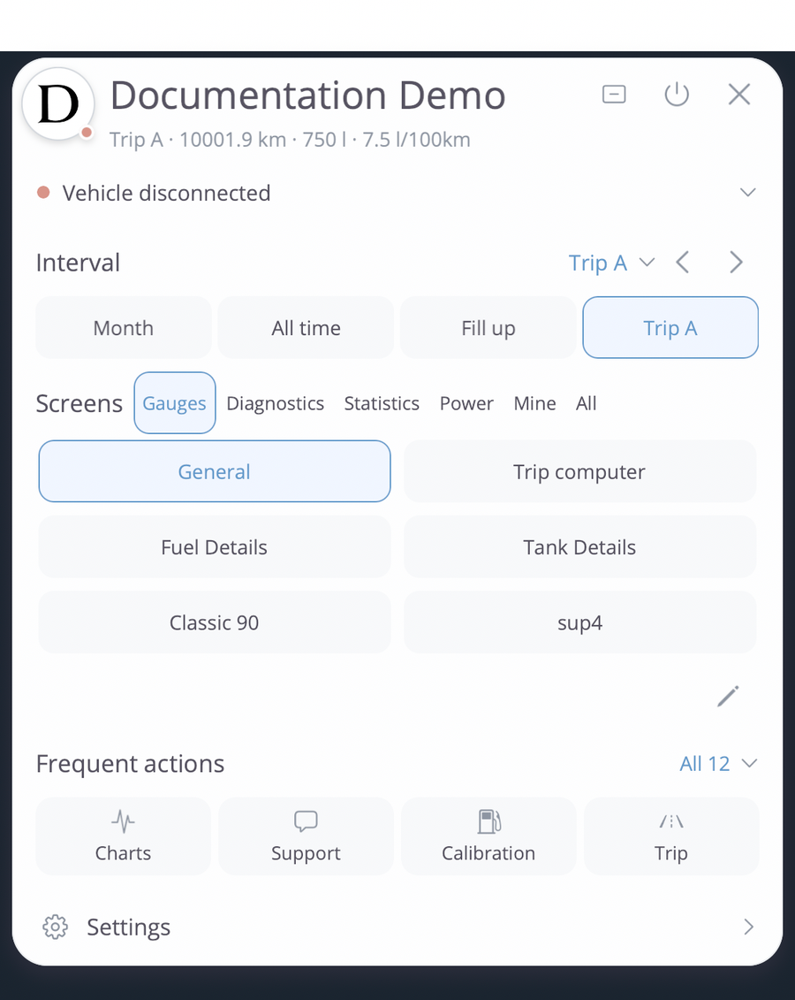
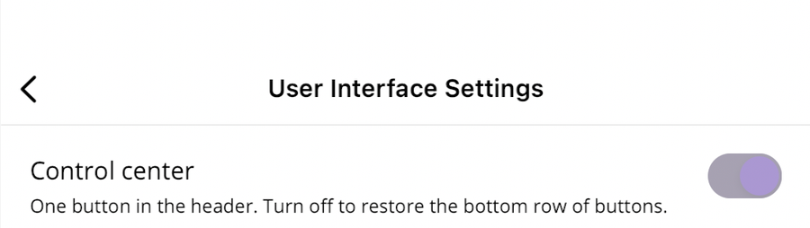

[User's Manual](user-manual.md#control-center) | [Index](../README.md) | [Русский](../ru/control-center.md)

# Control Center

The **Control center** brings period selection, screen navigation, connection status, and actions into a single panel over the gauges. The switch in settings is also called **Control center**.

Classic navigation with the bottom **Trip**, **Actions**, and **Screens** buttons remains available. Both layouts open the same data and features; choose whichever suits you.

The screenshots show the English Mac Catalyst app. On a phone, the available screens and layout depend on the window size and vehicle profile.

## Contents
{:.no_toc}
* TOC
{:toc}

## Open and close the panel

Tap the round **D** button in the gauge screen's header. The panel opens over the current readings. At the top, it shows the vehicle name and any available distance, fuel, and consumption figures for the selected interval.

{: width="400" }

*On narrow screens, scroll groups and intervals horizontally. Screens within a group may span several pages.*

Close the panel with the × button or by tapping outside it. On Android, you can also use the system **Back** button or gesture. Closing the panel returns to the gauges.

## Check the connection

The row below the vehicle name shows connection status. Tap it for connection details and available commands, including **Reconnect** to try again.

**No data** beside an interval means readings are unavailable; it does not mean zero distance or consumption. If the connection fails, check the adapter and vehicle profile.

## Select an interval

Under **Interval**, choose **Auto Trip**, **Day**, **Week**, **Month**, or another available period. Scroll the buttons or use the arrows to reach more intervals. Tap the current interval's name to expand the full list with available distance, fuel, and consumption figures. Auto Trip and Trip A/B also offer a reset action with confirmation.

Selecting an interval changes the gauge screens just like **Trip** in the classic interface. This switches the current counters; to find a past trip, open its history.

## Open a screen or log

Screens are grouped by purpose:

- **Gauges**: main vehicle and trip readings.
- **Diagnostics**: diagnostic and sensor screens available in the profile.
- **Statistics**: fueling, event, and trip history, statistics, and service reminders.
- **Power**: efficiency and vehicle performance screens.
- **Mine**: additional custom screens.
- **All**: the complete available list.

Scroll the group names if they do not all fit. If the tiles span more than one page, use the arrows and page counter below them. Tap a tile to open its screen. The selection depends on the profile and installed layouts.

The pencil button opens screen-list settings. For screen selection and appearance, see [Main Screen Settings](screen-settings.md).

## Run an action

**Frequent actions** includes commands such as **Fuel up**, **Logbook**, **Service**, **Trip**, **Calibration**, and **Charts**. The short label **Trip** here opens missing-trip entry; choose the current reporting period in **Interval** above.

The panel orders actions by how often you use them. If a command is not visible, tap **All** beside the action count to expand the list. Open **Settings** at the bottom to configure the connection, vehicle, or interface.

## Restore the classic buttons

Open **Settings → User Interface Settings**, turn off **Control center**, and go back. The setting is saved when you leave the page. The familiar bottom row returns on the gauge screen. To use the panel again, turn the same switch on and return to the gauges.

{: width="600" }

Switching navigation layouts does not require a new vehicle profile or new records. The manual retains classic paths through **Screens** and **Actions**, with the equivalent Control center entry points described alongside them.

Next: [Trips and expenses](trips-and-expenses.md), [Calibration](calibration.md), [Sensor charts](charts.md).
