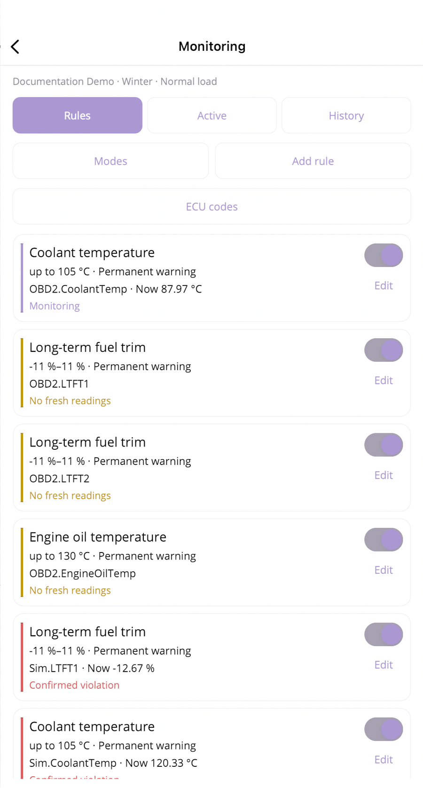
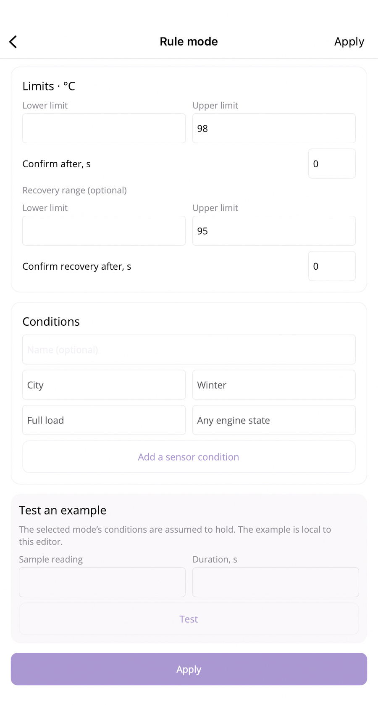
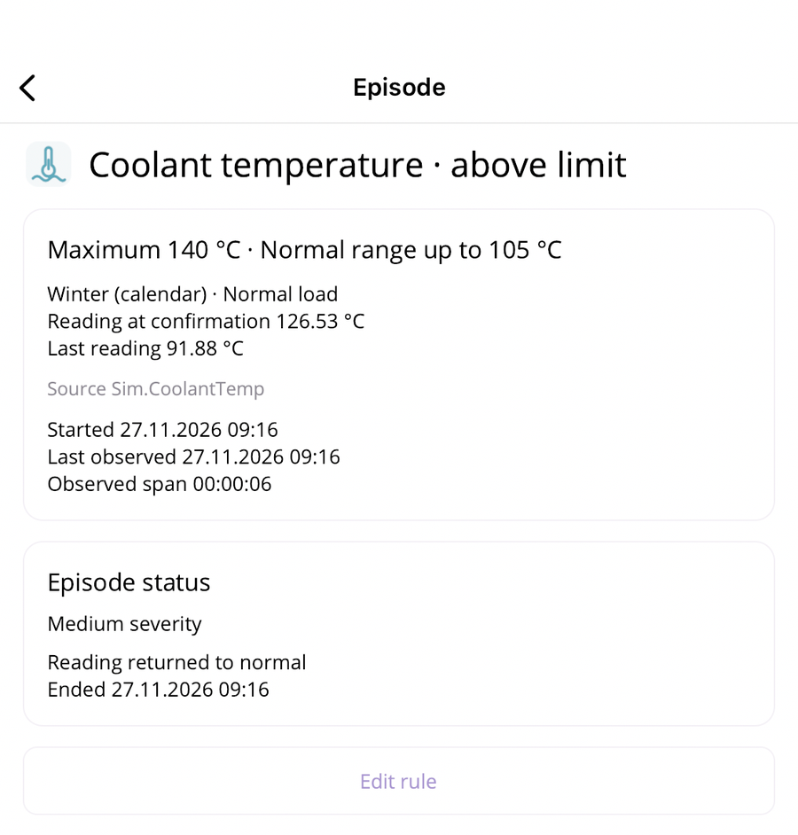

[English](monitoring.md) | [Русский](../ru/monitoring.md)

# Vehicle Monitoring

Monitoring checks the selected vehicle's sensor readings while hobDrive receives data. The history for that profile records confirmed threshold violations and ECU codes.

The screenshots show the English Mac Catalyst app with sample data. Controls may be arranged differently on a phone.

## Open Monitoring

On the **Diagnostics** screen, tap **Monitoring** next to the reset buttons at the bottom. You can also find **Monitoring** in **Settings**, after **Vehicle Settings**. From a numeric sensor's details, **Monitor this sensor** opens the rule editor with that sensor selected.

The **Rules** tab shows each rule's switch, current limits, and status. **Monitoring** means readings are coming in. The card explains what the rule is waiting for when data is missing. Disabled rules appear dimmed.

{: width="400" }

## Enable a built-in rule

Open **Rules**, find the check you want, and turn on its switch. Tap **Edit** on the rule card to change its limits, confirmation delay, or alerts.

| Rule | What to configure |
|---|---|
| **Personal speed limit** | Set your own limit. Add a mode for each road type if you want different limits for city and highway driving. |
| **12 V charging voltage** | Check the voltage and RPM sources. Review the limits and confirmation delay separately for when the engine is running and when it is stopped. |
| **Tire pressure by load** | Choose the sensor for the wheel you want to monitor and set ranges for normal and full load. Once enabled, these ranges are used for that wheel. |

These three checks are off by default. Built-in checks for coolant, engine oil, transmission fluid, long-term fuel trim, and supported tire pressure sensors take their initial limits from the vehicle profile. Changes to operating ranges take effect when the profile is loaded. If you set custom limits in the editor, use **Restore profile defaults** to use the vehicle's settings again.

## Create a custom rule

1. Tap **Rules → Add rule**. Find a sensor by name, ID, or description.
2. Open a mode under **Rule modes**. Enter a lower limit, an upper limit, or both.
3. Use **Confirm after, s** to set how long a reading must stay outside the limits. If needed, set a **Recovery range (optional)** and a separate recovery delay.
4. Tap **Apply**, then choose the severity, alert type, icon, and sound. Tap **Save**.

Tap **Add mode** if the limits depend on conditions. A mode can use the road type, season, load, engine state, or a reading from another sensor. A matching specific mode takes precedence over the general mode. Use **Test an example** to enter a sample reading and duration and see the result in the editor.

In the example below, the rule applies in the city in winter with a full load. A reading above 98 °C crosses the upper limit. A reading of 95 °C or below meets the recovery limit.

{: width="400" }

Use **Rules → Modes** to set the current road type, choose winter months or override the season, and set the vehicle load. Road type resets when the trip changes. The selected load applies until you change it.

## How warnings appear

| Alert type | Where to see the event |
|---|---|
| **Permanent warning** | On the **Active** tab and in **Diagnostics** while the violation continues. The status bar shows up to two distinct icons in severity order and a count of the other warning types. Tap an icon to open Diagnostics. |
| **Pop-up warning** | Appears once in the app. When hobDrive is in the background, it can send a system notification if allowed. Tap the system notification to open the episode. |
| **History only** | Under **History** without a pop-up. |

For example, a personal speed limit of 70 km/h can trigger a pop-up when a confirmed reading reaches 88 km/h.

The **Automatic** icon follows the purpose of the built-in rule. An arbitrary sensor uses the general warning icon, and tire pressure uses TPMS icons. The icon appears in Diagnostics, the in-app pop-up, and History.

Tap **Play** in the rule editor to preview a sound. Choose **System default**, **Classic warning**, **Classic code alert**, **Chime**, **Double pulse**, **Urgent alert**, or **Off**. **System default** uses the device's standard notification sound. The app's general sound setting also applies to monitoring. On Android, background notifications use the channel for the selected sound.

hobDrive tracks active and pending ECU codes automatically. Go to **Rules → ECU codes** to choose a separate sound for each group. Active codes have high severity and pending codes have medium severity. A clock on the engine icon identifies pending codes.

## Find an event in History

Open **Monitoring → History → Filters**. The selected filters apply together.

- **Events** shows warnings, all ECU codes, only active MIL codes, or only pending codes.
- **Severity** shows low, medium, or high severity events. If an episode's severity rises, History shows the level it reached.
- **Warning type** shows permanent, pop-up, or history-only sensor warnings.

Tap **Apply filters**. To see every event again, tap **Reset filters**, then **Apply filters**. The history icons by the section headings in Diagnostics open History with the corresponding event type selected.

Tap an event to see the reading, threshold, conditions that applied, duration, and how the episode ended. The sample episode below reached 140 °C against a limit of 105 °C. Its last reading of 91.88 °C and the recovery status show how the violation ended. These are simulator readings, not measurements from a real vehicle.

{: width="400" }
