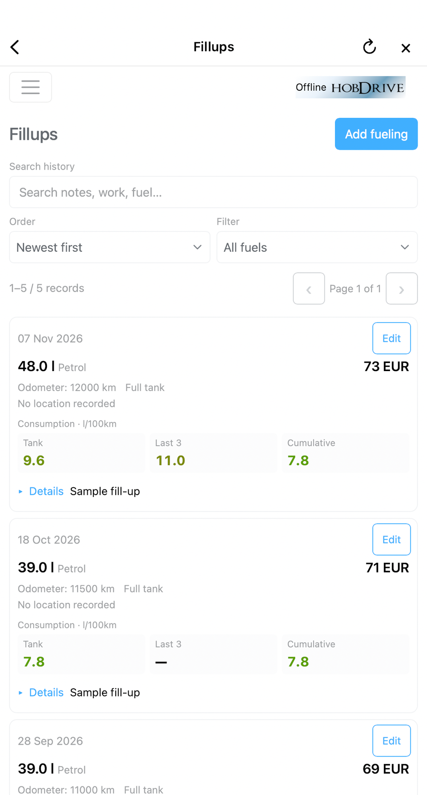
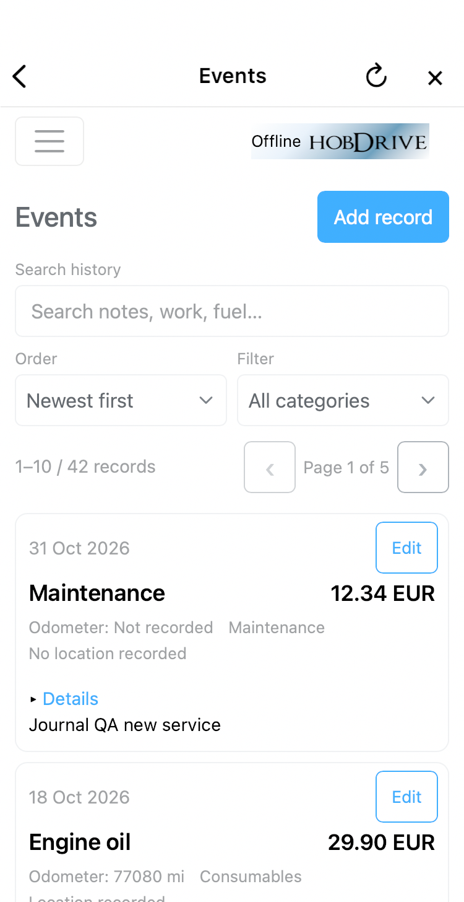

[User's Manual](user-manual.md#trips-and-expenses) | [Index](../README.md) | [Русский](../ru/trips-and-expenses.md)

# Trips and Expenses

hobDrive provides current trip counters, past trip reports, and logs of fill-ups and maintenance. Each answers a different question: how far you drove today, how much fuel a trip used, or how much you spent on the vehicle this month.

The screenshots show the English app with sample records. Work descriptions, amounts, and currencies are examples.

## Contents
{:.no_toc}
* TOC
{:toc}

## Choose the right view

| What you need | Where to look |
|---|---|
| Distance, time, and fuel use for the current trip or period | **Trip Computer**, using **Trip** to select a period, or **Interval** in the Control center |
| Past months, days, and individual trips | **Statistics & Events → Statistics**, or **Trip history** in the Control center |
| Fill-up costs and consumption calculated from records | **Statistics & Events → Fillups**, or **Fueling history** in the Control center |
| Maintenance and other expenses | **Statistics & Events → Events**, or **Event history** in the Control center |
| Expense charts and trip comparisons in the cloud report | [Trip Statistics and Online Analytics](statistics.md) |

In the classic interface, open **Statistics & Events** from **Screens**. In the [Control center](control-center.md), logs and trip history are in the **Statistics** group.

## Current distance and fuel use

Select **Auto Trip**, **Day**, **Week**, **Month**, **All time**, **Fill up**, or **Trip A / Trip B**. The main screens switch to that period. You can compare distance, time, fuel consumed, average consumption, and trip cost.

An automatic trip is separated from the next one by a gap in the connection to the vehicle; the required gap is set in vehicle settings. **Trip A / Trip B** are useful for a particular route or reference measurement because you reset them yourself. The **Fill up** period restarts when you enter a new fill-up.

Set the fuel price through its action or by tapping the relevant cost reading. Estimated trip cost depends on that price and calculated fuel use. Journal amounts are the actual expenses you enter, so they can differ from estimated trip costs.

## Add a fill-up

Choose **Actions → New Fueling**, **Fuel up** in the Control center, or **Add fueling** in the journal.

1. Check the date and fuel type, especially for a dual-fuel vehicle.
2. Enter the fuel volume, unit price, and total cost. Related fields recalculate as you enter values.
3. Enter the vehicle's actual odometer reading. If it differs from hobDrive's suggestion, check the correction method you have selected.
4. Mark **Full tank** only if you filled the tank completely. Add any notes or tags, then save.

Full-tank marks define the completed intervals used for [calibration](calibration.md). Synchronizing the current odometer at a fill-up, changing the distance factor, and adding a missing trip are separate operations.

{: width="400" }

*A card shows fuel volume, cost, odometer, and three consumption estimates. Expand Details to see additional fields.*

## Add maintenance or another expense

Choose **Actions → New Record**, **Service** in the Control center, or **Add record** in the events journal. Enter the work or category, date, odometer, amount, and currency. Notes and tags help you find a purchase or service later.

If the work belongs to a maintenance plan, also use [Service Intervals and Reminders](service-reminders.md), where you can mark it complete and start the next cycle.

{: width="400" }

## Find, edit, or delete a record

Search covers the entire history, including records on other pages. Enter part of a note, work description, or fuel name, then narrow the results by fuel type or category and choose a sort order. The fill-up journal also offers separate sort options for each consumption figure.

Use **Per page** to show 10, 25, or 50 records. Move between pages with **Previous / Next**. **Clear search and filters** restores the full list.

Tap **Edit** on a card. **Details** contains additional fields and a delete action with confirmation. After saving or canceling, the journal restores your search, filters, page, and scroll position. If an edited record no longer matches the filter, search for it again.

Recorded coordinates can be opened on a map. The journal cannot reconstruct a missing location from the date; viewing the map requires internet access.

## Read consumption figures and totals

The fill-up journal shows three estimates:

- **Tank**: consumption since the previous fill-up; easiest to interpret with consecutive full tanks.
- **Last 3**: an estimate based on the last three fill-ups.
- **Cumulative**: overall consumption based on the preceding journal records.

These figures use the fuel volumes and odometer readings in the journal. They depend on complete records and need not match the current average on a gauge screen. Partial fill-ups can distort individual estimates; for a precise comparison, use completed full-to-full intervals. Colors help compare entries within the list, rather than define a normal consumption level for your vehicle.

Scroll to the totals and check their scope:

- **This page**: only records on the current page.
- **Matching records**: every record matching the search and filters, including other pages.
- **Entire history**: the whole journal.

Amounts in different currencies are kept separate; no exchange-rate conversion is performed. Fuel volumes use the selected units. If a total looks unexpected, check the active filter, total scope, and currency first.

## Past trips and the online report

In **Statistics**, choose a period and open a month, day, or individual trip. If the local report has not been generated or is out of date, tap **Regenerate all statistics** on the **Statistics & Events** page and wait for it to finish. A report cannot recover a past trip without recorded data.

Local logs do not require cloud uploads. Online analytics requires synchronization to be enabled separately. In the online report, you can compare trips, view expenses over time and by category, and choose a period, grouping, currency, and filters. Tapping an expense chart bar limits the source table to that period. For the full workflow, see [Trip Statistics and Online Analytics](statistics.md).

## If hobDrive was not running during a trip

**Record missing trip** lets you add the missing distance and an estimate of fuel consumed. It does not recreate sensor readings, the route, or driving conditions. Use a new, fully recorded section when calculating calibration factors.

Make regular [backups](user-manual.md#data-management-backups-and-cloud) to protect your records and settings.
