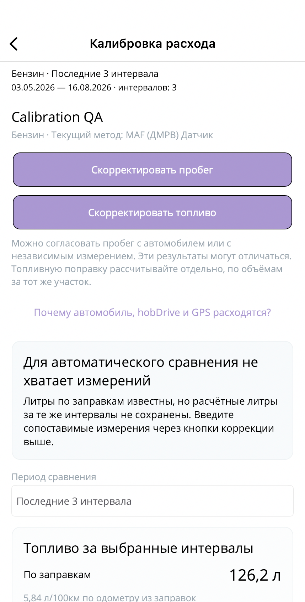
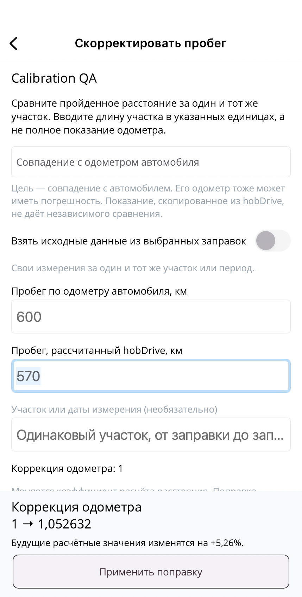
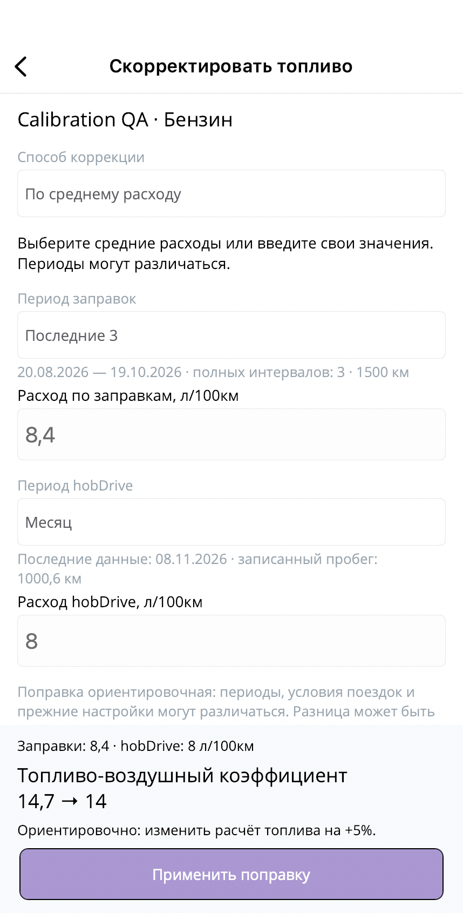
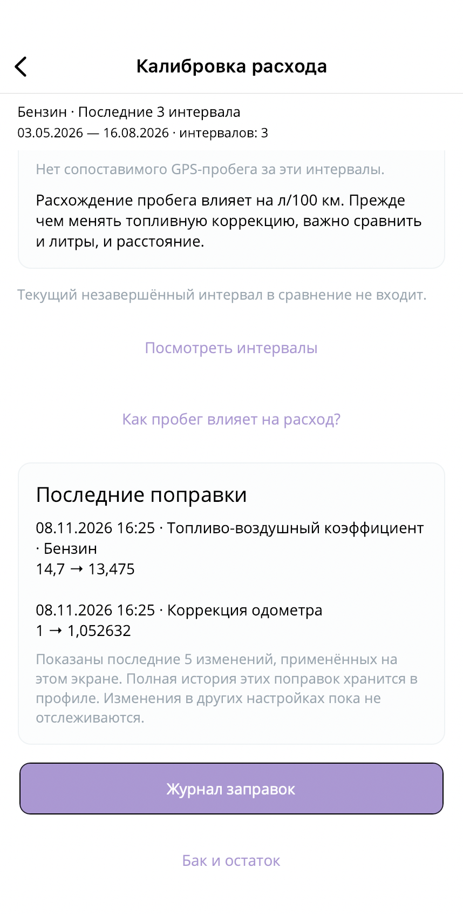

[Руководство пользователя](user-manual.md#калибровка-и-точность-расчетов) | [Индекс](../README-ru.md) | [English](../en/calibration.md)

# Калибровка пробега и расхода

Калибровка помогает согласовать расчёты hobDrive с проверенным пробегом и расходом топлива. Приложение показывает исходные данные, предлагает поправку и сохраняет историю её применения. Начните с пробега: его ошибка влияет и на расход в л/100 км.

Скриншоты сделаны на Mac Catalyst с тестовыми данными. На телефоне расположение элементов может отличаться.

## Содержание
{:.no_toc}
* TOC
{:toc}

## Как открыть

В классическом интерфейсе выберите **Действия → Калибровка расхода**. В [Едином пульте](control-center.md) откройте **Частые действия**, при необходимости раскройте список **Все** и выберите **Калибровка**. Полное название действия — **Калибровка расхода**; здесь настраиваются и топливо, и расстояние.

Не путайте этот экран с действием **Бак и остаток**: оно задаёт ёмкость бака и исходное количество израсходованного топлива для оценки остатка.

{: width="400" }

*Сначала выберите, что проверять: расстояние или количество топлива.*

## Подготовьте исходные данные

1. Проверьте профиль автомобиля, метод расчёта топлива и единицы измерения.
2. Для проверки пробега запишите одометр автомобиля в начале и конце участка либо подготовьте независимое измерение пути. hobDrive должен полностью записать тот же участок.
3. Для проверки по заправкам отмечайте **Полный бак** и записывайте все промежуточные заправки, включая частичные. Вводите фактический одометр с приборной панели.
4. Для сравнения одинаковых участков используйте данные, собранные с неизменными методом и коэффициентами. Пропуски поездок и ручные добавления могут исказить результат.

Если на заправке вы приняли подсказанный hobDrive одометр, сравнение с ним не будет независимой проверкой расстояния.

## Что показывает экран калибровки

В двухтопливном профиле сначала выберите нужное топливо. Затем выберите **Последний полный интервал**, **Последние 3 интервала**, **Последние 90 дней** или **Все завершённые интервалы**.

Для каждого завершённого интервала нужны начальная и конечная заправки до полного бака. Объём начальной заправки не входит в расход: учитываются все следующие заправки, включая конечную полную. Например, между двумя полными баками были частичная заправка 20 л и конечная 40 л, а одометр вырос на 600 км. Израсходовано 60 л, расход — 10 л/100 км.

Кнопка **Посмотреть интервалы** раскрывает даты, объёмы и показания одометра. При ошибке в записи перейдите в **Журнал заправок**, исправьте её и вернитесь: результаты обновятся. Текущий незавершённый интервал в сравнение не входит.

Прочерки в строках **Расчёт hobDrive**, **Пробег hobDrive** или **Пробег GPS** означают, что сопоставимых исторических измерений нет. Приложение не восстанавливает их из сегодняшних настроек. Для поправки можно отдельно ввести собственные измерения.

## Скорректировать пробег

1. Нажмите **Скорректировать пробег**.
2. Выберите цель: **Совпадение с одометром автомобиля** или **Независимое расстояние / GPS**.
3. Введите длину участка по ориентиру и путь hobDrive за тот же участок. Нужен именно пройденный путь: например, 600 км, а не полное показание одометра 124 600 км.
4. Если берёте исходные данные из выбранных заправок, сопоставляйте только показанные завершённые интервалы. Промежутки между ними могли быть исключены.
5. Проверьте предложение внизу экрана, подтвердите сопоставимость измерений и нажмите **Применить поправку**. До применения можно вернуться назад без изменения коэффициента.

{: width="400" }

*В примере коэффициент расстояния меняется с 1 на 1,052632. Предпросмотр остаётся доступен при прокрутке.*

Меняется коэффициент расчёта расстояния. Отдельная поправка скорости и текущее абсолютное значение одометра сохраняются. GPS-расстояние берётся из самостоятельно проверенного трека: отдельного автоматического накопителя GPS-пробега для калибровки пока нет.

Подробно о выборе ориентира и формуле: [Скорость и пробег](speed-diff.md).

## Скорректировать топливо

Нажмите **Скорректировать топливо**. Для каждого вида топлива в двухтопливном профиле поправка подбирается отдельно.

### По среднему расходу

Этот способ выбран по умолчанию. На стороне заправок можно взять **Все заправки (журнал)**, завершённые полные интервалы или своё значение. На стороне hobDrive доступны неделя, месяц, всё время, текущий бак, Trip A/B и ручной ввод.

Проверьте периоды и числа с обеих сторон. Если периоды различаются, поправка будет ориентировочной: различия могут быть связаны с условиями поездок и пробегом. Например, 8,4 л/100 км по заправкам и 8,0 л/100 км в hobDrive дают предложение увеличить будущий расчёт топлива на 5%.

{: width="400" }

*Приложение само выбирает параметр текущего метода. Для MAF увеличение расчётного топлива достигается уменьшением AFR.*

**Все заправки (журнал)** соответствует показателю **Накопленный** в журнале. **Все полные интервалы** — другой ориентир, построенный по явно отмеченным полным бакам. Они могут дать разные значения. Если журнал объединяет два топлива, для поправки одного топлива используйте его полные интервалы или своё измерение.

### По объёму топлива

Выберите **По объёму топлива**, если есть фактически израсходованный объём и расчётные литры hobDrive за **одинаковые интервалы**. Фактическую сторону можно заполнить из выбранных полных интервалов; расчётную укажите за те же участки. Подтвердите полноту записи и неизменность настроек.

Этот способ позволяет проверить топливо отдельно от расхождения пробега. Нельзя сравнивать литры за один месяц с заправками за другой период. Две произвольные частичные заправки также не показывают, сколько топлива было израсходовано.

В обоих способах проверьте старое и новое значения, затем нажмите **Применить поправку**. Поддерживаются десятичная точка и запятая. Формулы для разных методов приведены в статье [Методы расчёта расхода и коэффициенты](fuel-methods.md).

## После применения

Поправка действует на последующие измерения. Накопленные литры, километры и старые средние не пересчитываются. Проверьте результат на новом полностью записанном участке.

В блоке **Последние поправки** показаны последние пять применений с датой, исходными данными и изменённым параметром. Это история действий калибровки; изменения через другие настройки не образуют полную историю всех правок профиля.

{: width="400" }

Если форма сообщает, что нужны новые данные, выберите более поздний период или введите новое измерение, полученное с текущими настройками. Среднее, включающее данные до предыдущей поправки, и уже применённые измерения не подходят для повторного расчёта. Если поправка сохранена, но приложение просит перезапуск, перезапустите hobDrive перед новыми измерениями.

## Если результат неожиданен

Проверьте единицы, даты, отметки полного бака, пропущенные заправки и поездки. Коэффициент не восстанавливает отсутствующие данные. При смене размера колёс, источника скорости или метода расхода соберите новый контрольный участок.

Для двух топлив сравнивайте одинаковые показатели: в этой форме литры выбранного топлива относятся к общему пробегу автомобиля. Часовой расход на холостом ходу помогает заметить грубую ошибку метода, но не заменяет измерение по заправкам.

Связанные материалы: [Пробеги и расходы](trips-and-expenses.md), [Основные принципы расчёта топлива](fuel-questions.md), [Бак и остаток в руководстве](user-manual.md#детали-топлива).
