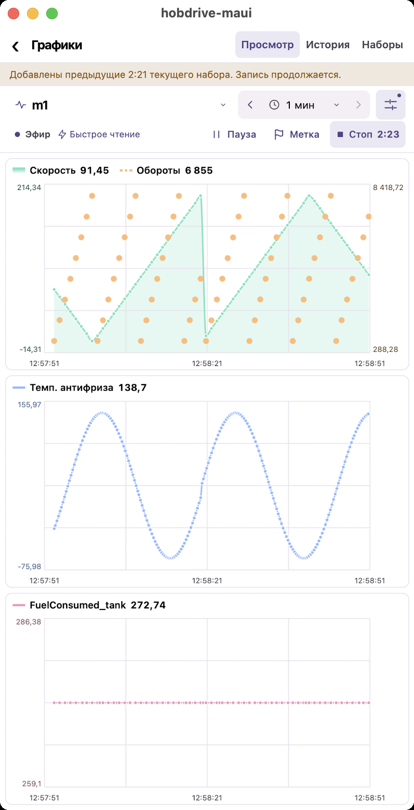
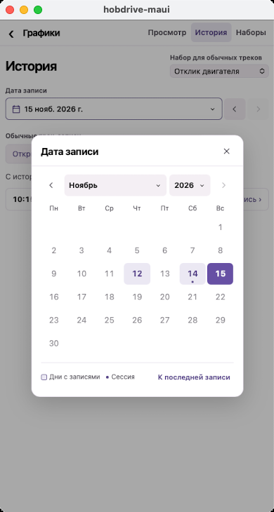
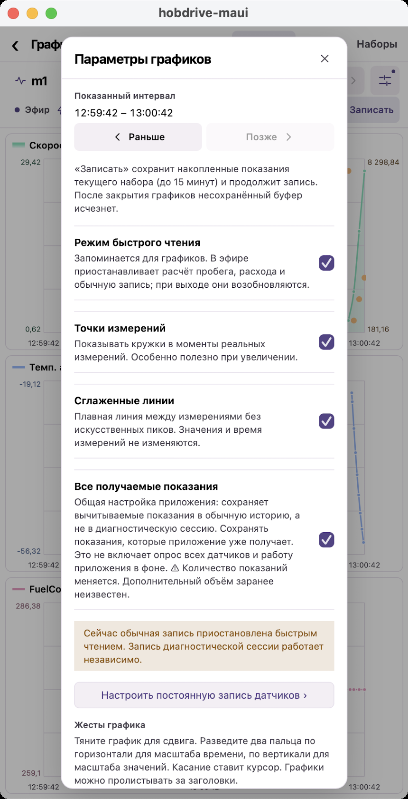

[Руководство пользователя](user-manual.md#графики-датчиков) | [Индекс](../README-ru.md) | [English](../en/charts.md)

# Графики датчиков

Экран **Графики** показывает несколько датчиков на общей временной оси. Можно наблюдать их в эфире, остановить просмотр, изучить сохранённую историю и в полной версии записать диагностическую сессию с метками. Для сравнения, например, оборотов и положения заслонки не нужно переключаться между приборными экранами.

Это отдельный инструмент для показаний датчиков. Графики денежных расходов и заправок описаны в статье [Статистика поездок и онлайн-аналитика](statistics.md).

Скриншоты сделаны на Mac Catalyst с тестовыми сигналами; показанные кривые не являются примером диагностики неисправности.

## Содержание
{:.no_toc}
* TOC
{:toc}

## Открыть графики и выбрать набор

В классическом интерфейсе выберите **Экраны → Графики** или **Действия → Графики**. В [Едином пульте](control-center.md) используйте действие **Графики**; если его нет среди частых, раскройте **Все**.

Откройте **Наборы** и выберите готовый набор, например **Отклик двигателя** или **Топливные коррекции**. Кнопка **Открыть** переключает просмотр на выбранный набор. Доступность показаний зависит от текущего профиля ЭБУ и подключения.

В демоверсии в наборе доступны до трёх датчиков, в полной версии — до 32. Для ранее сохранённого большого набора демоверсия показывает первые три датчика, сохраняя полный состав набора.

{: width="400" }

*Сигналы одного набора можно разместить вместе или на отдельных графиках. Вверху доступны управление временем, пауза и запись.*

## Смотреть показания в эфире

Во вкладке **Просмотр** режим **Эфир** показывает поступающие значения. Выберите удобное **Окно времени**, чтобы видеть короткий отклик или более длинный участок.

- **Пауза** останавливает следование за текущим временем и позволяет рассмотреть участок. **Вернуться в эфир** снова показывает новые значения.
- Потяните график для сдвига по времени. Разведите два пальца по горизонтали для изменения масштаба времени, по вертикали — масштаба значений.
- Касание ставит курсор. Подписи показывают ближайшее реальное измерение; **Снять курсор** убирает его.
- Если графиков много, пролистывайте страницу за их заголовки. **Авто Y** возвращает автоматический масштаб значений.

В **Параметрах графиков** можно включить **Точки измерений** и **Сглаженные линии**. Точки помогают увидеть, насколько часто приходили данные. Сглаживание меняет вид линии между измерениями, сохраняя время и значения самих измерений. Большой пропуск данных отображается разрывом: линия через него не означает непрерывную запись.

## Собрать свой набор

1. Откройте **Наборы → Новый набор**. Для готового набора выберите **Изменить копию**, чтобы сохранить исходный вариант.
2. Введите название и нажмите **Добавить сенсор**. Найдите датчик по названию или ID.
3. Разместите сигналы на одном графике для сопоставления либо выберите **Отдельный график**. Для линии можно настроить цвет, толщину и тип: сплошная, пунктир, точки или с заливкой.
4. Нажмите **Сохранить**, затем **Открыть**. **Отмена** оставляет прежний набор без изменений.

Если датчик отмечен как **Недоступен**, проверьте профиль ЭБУ и поддержку параметра автомобилем. **Ожидание показаний** и **Нет свежего значения** также не означают нулевое значение датчика.

## Записать диагностическую сессию

Запись сессий доступна в полной версии.

1. Перейдите в эфир и выберите набор с доступными датчиками.
2. Нажмите **Записать сессию** (на компактном экране — **Записать**).
3. При необходимости нажимайте **Метка**, чтобы отметить интересующий момент.
4. Нажмите **Стоп** и откройте результат в **Истории**.

В сессию попадает доступный накопленный фрагмент текущего набора до нажатия записи — до 15 минут. Затем запись продолжается. Это удобно, если интересный момент уже произошёл, пока графики были открыты. Несохранённый буфер исчезает после закрытия графиков; он не заменяет постоянную запись.

При просмотре сессии команда **Перейти к метке** помогает вернуться к отмеченному событию. Если запись прервалась, проверьте её в истории и свободное место на устройстве.

## Открыть историю

Перейдите во вкладку **История**. В календаре отмечены дни с данными; выберите день и нужную диагностическую сессию или интервал обычных трек-записей. Стрелки помогают переходить между днями с записями.

{: width="400" }

Для обычных треков важен выбранный набор: прошлые показания появятся только для датчиков, которые действительно записывались. Используйте **Подобрать сенсоры с историей** или фильтр **Только с историей**, если в текущем наборе подходящих данных нет. Выбор датчика сегодня не создаёт его историю за прошлую поездку.

Удаление сессии командой **Удалить с устройства** удаляет локальную запись. Если она уже была отправлена в облако, облачная копия остаётся.

## Быстрое чтение и обычная запись

В **Параметрах графиков** есть **Режим быстрого чтения**. В эфире он сосредотачивает опрос на выбранных датчиках. При этом временно приостанавливаются расчёт пробега, расхода и запись обычных треков. После выхода из графиков они возобновляются. Настройка запоминается для следующего открытия графиков.

{: width="400" }

*Перед диагностическим замером проверьте быстрое чтение: оно влияет на обычную статистику поездки.*

Диагностическая сессия записывается независимо от обычных треков и работает при быстром чтении. Для повседневного учёта пробега и топлива оставляйте быстрое чтение выключенным. Команда **Настроить постоянную запись датчиков** относится к обычной истории приложения.

Если история пуста, проверьте дату, набор, доступность датчиков и наличие сохранённых записей. Для обычных треков также проверьте постоянную запись и то, не было ли включено быстрое чтение. Интернет не создаёт отсутствующие локальные измерения.
