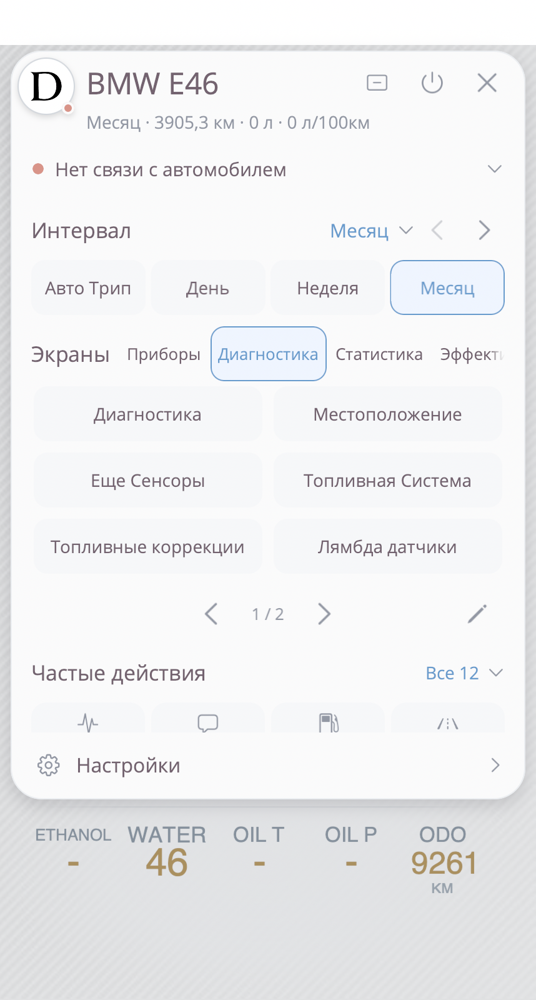
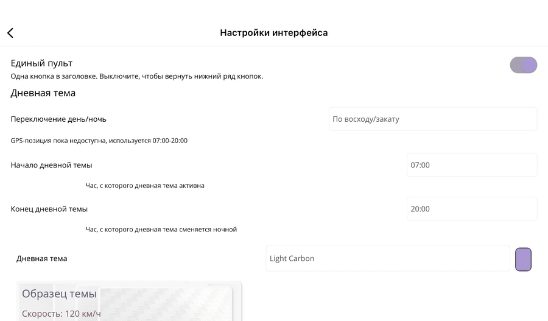

[Руководство пользователя](user-manual.md#центр-управления-единый-пульт) | [Индекс](../README-ru.md) | [English](../en/control-center.md)

# Центр управления: Единый пульт

**Единый пульт** объединяет выбор интервала, переходы к экранам, состояние подключения и действия в одной панели поверх приборов. В настройках этот режим называется именно **Единый пульт**.

Классическая навигация с нижними кнопками **Поездка**, **Действия** и **Экраны** остаётся доступной. Обе схемы открывают те же данные и функции; выберите удобную.

Скриншоты сделаны на Mac Catalyst. На телефоне набор экранов и расположение элементов зависят от размера окна и профиля автомобиля.

## Содержание
{:.no_toc}
* TOC
{:toc}

## Открыть и закрыть

Нажмите круглую кнопку с буквой **D** в заголовке приборного экрана. Пульт откроется поверх текущих показаний. В верхней части видны имя автомобиля и доступные пробег, топливо и расход выбранного интервала.

{: width="400" }

*На узком экране группы и интервалы можно пролистывать по горизонтали; экраны внутри группы разбиты на страницы.*

Закройте пульт крестиком или нажатием вне панели. На Android можно использовать системную кнопку или жест **Назад**. Закрытие возвращает к приборам.

## Проверить подключение

Строка под именем автомобиля показывает состояние связи. Нажмите её, чтобы раскрыть подробности подключения и доступные команды, включая **Повторить** для новой попытки соединения.

Надпись **Нет данных** рядом с интервалом означает отсутствие доступных показаний. Она не равнозначна нулевому пробегу или расходу. При проблемах со связью проверьте адаптер и профиль автомобиля.

## Выбрать интервал

В блоке **Интервал** выберите **Авто Трип**, **День**, **Неделя**, **Месяц** или другой доступный период. Полосу кнопок можно прокручивать; стрелки открывают следующие интервалы. Нажатие на название текущего интервала раскрывает полный список с доступными пробегом, топливом и расходом. Для авто-поездки и Трип А/Б здесь также доступен сброс с подтверждением.

Выбор интервала меняет показания приборных экранов, как кнопка **Поездка** в классическом интерфейсе. Это переключение текущих счётчиков; для поиска прошлой поездки откройте историю.

## Перейти к экрану или журналу

Экраны сгруппированы по назначению:

- **Приборы** — основные показания автомобиля и поездки.
- **Диагностика** — диагностические и доступные в профиле экраны датчиков.
- **Статистика** — история заправок, событий и поездок, статистика и сервисные напоминания.
- **Эффективность** — соответствующие экраны эффективности и динамики.
- **Мои** — дополнительные пользовательские экраны.
- **Все** — полный доступный список.

Если группа не помещается, пролистайте полосу названий. Если плиток больше одной страницы, используйте стрелки под ними и счётчик страниц. Нажмите нужную плитку, чтобы открыть экран. Состав зависит от профиля и подключённых раскладок.

Кнопка с карандашом открывает настройку списка экранов. Подробнее о составе и оформлении: [Настройка главных экранов](screen-settings.md).

## Выполнить действие

В блоке **Частые действия** расположены команды вроде **Заправка**, **Журнал**, **Сервис**, **Поездка**, **Калибровка** и **Графики**. Короткая подпись **Поездка** здесь открывает ввод пропущенной поездки; текущий период выбирается выше, в блоке **Интервал**.

Пульт учитывает частоту использования команд. Если нужной команды нет среди видимых, нажмите **Все** с числом действий и выберите её в раскрытом списке. Для настройки подключения, автомобиля и интерфейса используйте **Настройки** внизу панели.

## Вернуть классические кнопки

Откройте **Настройки → Настройки интерфейса** и выключите **Единый пульт**, затем вернитесь назад: настройка сохраняется при закрытии страницы. На приборном экране появится привычный нижний ряд. Чтобы снова пользоваться пультом, включите тот же переключатель и вернитесь к приборам.

{: width="600" }

Переход между схемами навигации не требует заново создавать профиль или записи. В руководстве сохранены классические пути через **Экраны** и **Действия**; эквивалентные входы через пульт описаны рядом.

Дальше: [Пробеги и расходы](trips-and-expenses.md), [Калибровка](calibration.md), [Графики](charts.md).
