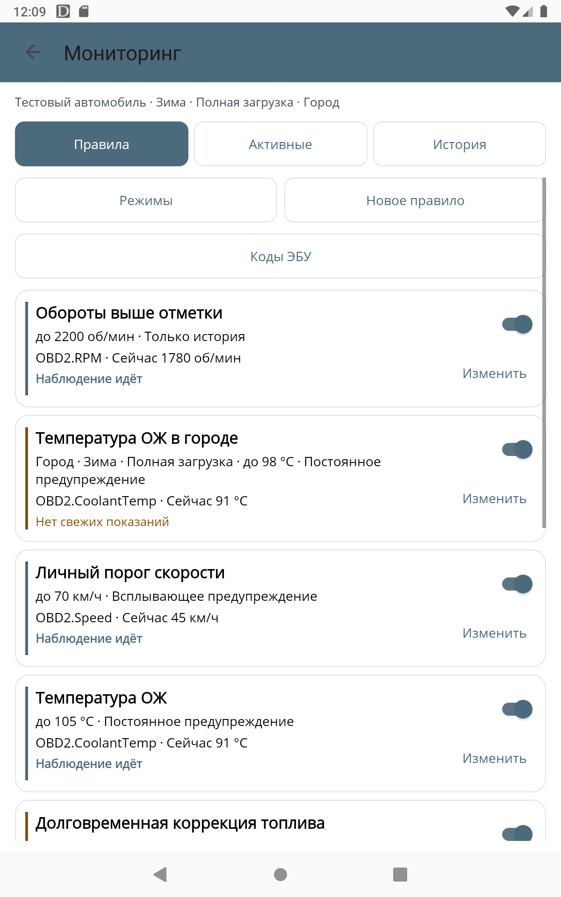
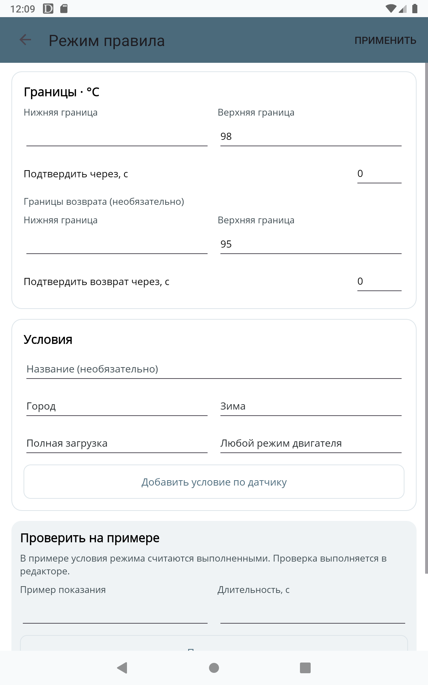
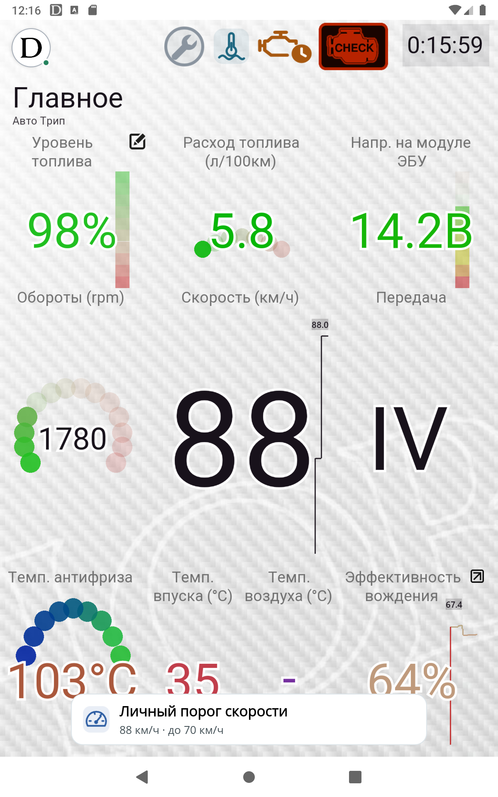
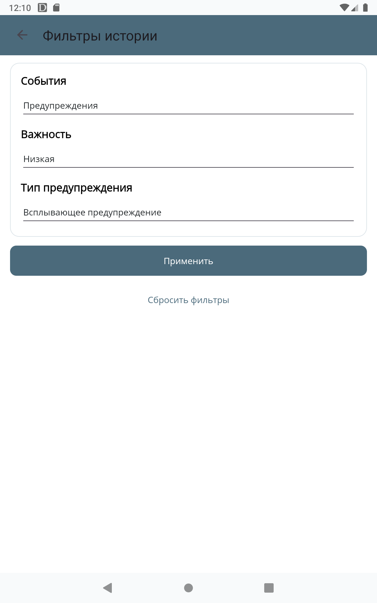
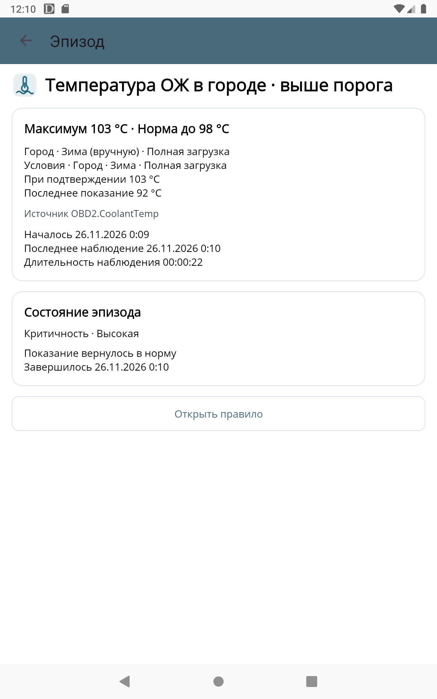

[English](../en/monitoring.md) | [Русский](monitoring.md)

# Мониторинг автомобиля

Мониторинг проверяет показания датчиков выбранного автомобиля, пока hobDrive получает данные. Приложение сохраняет подтверждённые нарушения и коды ЭБУ в истории этого профиля.

## Как открыть мониторинг

На экране **Диагностика** нажмите **Мониторинг** внизу рядом с кнопками сброса. Этот пункт также есть в **Настройках** после **Параметров автомобиля**. Из карточки числового датчика команда **Наблюдать** открывает редактор с уже выбранным датчиком.

Во вкладке **Правила** видны переключатель, действующие границы и состояние каждого правила. Подпись **Наблюдение идёт** означает, что показания поступают. Если нужных данных пока нет, карточка показывает причину ожидания. Выключенные правила приглушены.

{: width="400" }

## Включить готовое правило

Откройте **Правила**, найдите нужную проверку и включите её переключателем. Чтобы изменить границы, выдержку или уведомление, нажмите **Изменить** на карточке правила.

| Правило | Что настроить |
|---|---|
| **Личный порог скорости** | Укажите свой предел. Если для города и трассы нужны разные значения, добавьте режим для каждой дороги. |
| **Напряжение зарядки 12 В** | Проверьте источники напряжения и оборотов. Сверьте границы и выдержку отдельно для работающего и остановленного двигателя. |
| **Давление по загрузке** | Выберите датчик нужного колеса и задайте диапазоны для обычной и полной загрузки. После включения приложение использует этот режим давления для выбранного колеса. |

Эти три проверки по умолчанию выключены. Штатные правила температуры охлаждающей жидкости, масла двигателя и коробки, долговременной коррекции топлива и поддерживаемых датчиков давления в шинах берут исходные границы из профиля автомобиля. Изменения рабочих диапазонов подхватываются при загрузке профиля. Если вы настроили свои пороги в редакторе, нажмите **Вернуть настройки профиля**, чтобы снова использовать значения автомобиля.

## Создать своё правило

1. Нажмите **Правила → Новое правило**. Найдите датчик по названию, ID или описанию.
2. Откройте режим в разделе **Режимы правила**. Введите нижнюю границу, верхнюю границу или обе.
3. Поле **Подтвердить через, с** задаёт время, в течение которого показание должно непрерывно оставаться за границей. При необходимости заполните **Границы возврата** и задайте отдельную выдержку возврата.
4. Нажмите **Применить**, выберите критичность, способ сообщения, значок и звук. Затем нажмите **Сохранить**.

Если пределы зависят от условий, нажмите **Добавить режим**. Можно выбрать дорогу, сезон, загрузку, состояние двигателя или добавить условие по другому датчику. Подходящий специальный режим имеет приоритет над общим. Блок **Проверить на примере** позволяет ввести пробное показание и длительность. Результат проверки виден в редакторе.

В примере ниже правило действует в городе зимой при полной загрузке. Показание выше 98 °C выходит за верхнюю границу. Возврат подтверждается при показании 95 °C или ниже.

{: width="400" }

Текущие условия выбираются через **Правила → Режимы**. Там можно указать дорогу на эту поездку, отметить зимние месяцы или выбрать сезон вручную, а также задать загрузку. Дорога сбрасывается со сменой поездки. Загрузка действует до следующего изменения.

## Настроить частоту опроса

В редакторе правила откройте **Частота опроса**. Вариант **По профилю** показывает обычный интервал для этого правила. Температуры и долговременная коррекция по умолчанию опрашиваются раз в минуту, личный порог скорости — раз в секунду. Выберите **Свой интервал**, чтобы задать от 1 до 3600 секунд, или **Максимальная частота** для опроса так часто, как позволяет подключение.

**Ускорять при отклонении** включено по умолчанию. Например, при обычном интервале 60 секунд и выдержке 5 секунд мониторинг сначала дождётся очередного чтения. После первого выхода за пределы он будет запрашивать показание каждые 2,5 секунды до возврата в норму. Если выключить ускорение, подтверждение дождётся следующего чтения с обычным интервалом. Фиксированный интервал полезен, когда важнее заранее ограничить нагрузку на адаптер или ЭБУ.

Настройка задаёт частоту, которую запрашивает правило. Другой экран или правило может уже читать тот же датчик чаще, и мониторинг использует эти показания. Фактическое время чтения также зависит от очереди запросов и скорости связи.

## Как приходят предупреждения

| Способ показа | Где увидеть событие |
|---|---|
| **Постоянное предупреждение** | Во вкладке **Активные** и в диагностике, пока продолжается нарушение. В строке состояния видны до двух разных значков в порядке критичности и число остальных типов предупреждений. Нажатие на значок открывает диагностику. |
| **Всплывающее предупреждение** | Один раз внутри приложения. Когда hobDrive свёрнут, предупреждение приходит как системное уведомление, если приложению разрешено их показывать. По нажатию на системное уведомление открывается нужный эпизод. |
| **Только история** | Во вкладке **История** без всплывающего сообщения. |

В примере на главном экране сработал личный порог скорости. В сообщении видны фактические 88 км/ч и граница 70 км/ч.

{: width="400" }

Значок **Автоматически** выбирается по назначению встроенного правила. Для произвольного датчика используется общий значок предупреждения, а для давления в шинах — значки TPMS. Значок виден в диагностике, всплывающем сообщении внутри приложения и журнале.

Кнопка **Слушать** позволяет проверить выбранный сигнал. Доступны **Системный**, **Обычное предупреждение**, **Классический сигнал MIL**, **Короткий звон**, **Двойной сигнал**, **Тревожный сигнал** и вариант **Без звука**. **Системный** использует звук уведомлений устройства по умолчанию. Общая настройка звуков приложения действует и на мониторинг. На Android фоновые уведомления используют канал для выбранного сигнала.

hobDrive автоматически отслеживает активные и ожидающие коды ЭБУ. В **Правила → Коды ЭБУ** можно выбрать отдельный звук для каждой группы. Активные коды имеют высокую критичность, ожидающие — среднюю. Ожидающие коды отмечены значком двигателя с часами.

## Найти событие в истории

Откройте **Мониторинг → История → Фильтры**. Параметры применяются вместе.

- **События** позволяют оставить предупреждения, все коды ЭБУ, только активные MIL или только ожидающие коды.
- **Важность** отбирает события низкой, средней или высокой критичности. Если критичность эпизода выросла, история показывает достигнутый уровень.
- **Тип предупреждения** отбирает постоянные, всплывающие или записанные только в историю предупреждения по датчикам.

Нажмите **Применить**. Чтобы вернуть весь список, нажмите **Сбросить фильтры**, затем **Применить**. Значки истории рядом с заголовками в диагностике открывают журнал с уже выбранным видом событий.

{: width="400" }

Нажмите на событие, чтобы увидеть показания, порог, действовавшие условия, длительность и причину завершения. Например, в эпизоде ниже температура достигла 103 °C при границе 98 °C. Последнее показание 92 °C и состояние **Показание вернулось в норму** показывают, чем закончилось нарушение.

{: width="400" }
