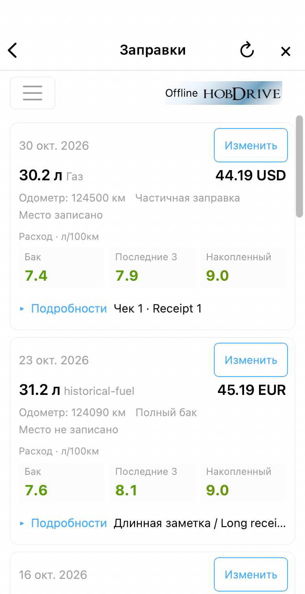
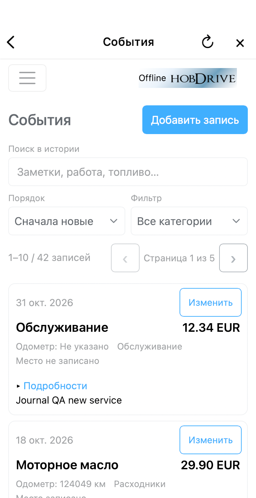

[Руководство пользователя](user-manual.md#пробеги-и-расходы) | [Индекс](../README-ru.md) | [English](../en/trips-and-expenses.md)

# Пробеги и расходы

В hobDrive есть текущие счётчики поездки, история поездок и журналы заправок и обслуживания. Они помогают ответить на разные вопросы: сколько проехали сегодня, какой расход был в поездке и сколько потратили на автомобиль за месяц.

Скриншоты локальных журналов сделаны на Mac Catalyst с тестовыми записями. Названия работ, суммы и валюты приведены для примера.

## Содержание
{:.no_toc}
* TOC
{:toc}

## Выберите нужный вид данных

| Задача | Где посмотреть |
|---|---|
| Пробег, время и расход текущей поездки или периода | **Бортовой компьютер**, выбор интервала **Поездка** или **Интервал** в Едином пульте |
| Прошлые дни, месяцы и отдельные поездки | **Статистика и события → Статистика**, либо **История поездок** в пульте |
| Заправки, их стоимость и расход по записям | **Статистика и события → Заправки**, либо **История заправок** в пульте |
| Обслуживание и прочие расходы | **Статистика и события → События**, либо **История событий** в пульте |
| Графики расходов и сравнение поездок в облачном отчёте | [Статистика поездок и онлайн-аналитика](statistics.md) |

В классическом интерфейсе раздел **Статистика и события** открывается через **Экраны**. В [Едином пульте](control-center.md) журналы и история поездок находятся в группе **Статистика**.

## Текущие пробег и расход

Выберите интервал: **Авто Трип**, **День**, **Неделя**, **Месяц**, **Все время**, **Заправка** или **Трип А / Трип Б**. Показания основных экранов переключатся на этот интервал. Здесь можно сравнить расстояние, время, израсходованное топливо, средний расход и стоимость поездки.

Авто-поездка определяется по перерыву в подключении к автомобилю; длительность перерыва задаётся в параметрах автомобиля. **Трип А / Трип Б** удобны для отдельного маршрута или контрольного замера: их сбрасывают вручную. Интервал **Заправка** начинается заново при вводе новой заправки.

Цена топлива задаётся отдельным действием или нажатием на соответствующий сенсор стоимости. Расчётная стоимость поездки зависит от этой цены и вычисленного топлива. Суммы в журнале — записанные вами фактические расходы; они могут отличаться от расчётной стоимости поездок.

## Добавить заправку

Откройте **Действия → Новая заправка**, действие **Заправка** в пульте или кнопку **Добавить заправку** в журнале.

1. Проверьте дату и вид топлива, особенно если автомобиль использует два топлива.
2. Укажите объём, цену и сумму: связанные поля пересчитываются при вводе.
3. Перепишите фактический одометр автомобиля. Если он отличается от подсказки hobDrive, проверьте выбранный способ коррекции.
4. Отметьте **Полный бак**, если действительно заправили до полного. Добавьте заметку или теги и сохраните запись.

Отметка полного бака нужна для завершённых интервалов [калибровки](calibration.md). Синхронизация текущего одометра при заправке, изменение коэффициента пробега и ввод пропущенной поездки решают разные задачи.

{: width="400" }

*В карточке видны объём, сумма, одометр и три оценки расхода; дополнительные поля раскрываются по команде «Подробности».*

## Добавить обслуживание или другой расход

Выберите **Действия → Новая запись**, действие **Сервис** в пульте или **Добавить запись** в журнале событий. Укажите работу или категорию, дату, одометр, сумму и валюту. Заметки и теги помогут позже найти нужную покупку или обслуживание.

Если работа связана с планом ТО, используйте также [Сервисные интервалы и напоминания](service-reminders.md): там можно отметить выполнение и перейти к следующему циклу.

{: width="400" }

## Найти, изменить или удалить запись

Поиск работает по всей истории, а не только по открытой странице. Введите фрагмент заметки, работы или названия топлива; дополнительно выберите вид топлива либо категорию и порядок сортировки. Для расхода в журнале заправок доступны отдельные варианты сортировки.

В поле **На странице** можно выбрать 10, 25 или 50 записей, а кнопками **Назад / Вперёд** перейти между страницами. Команда **Сбросить поиск и фильтры** возвращает полный список.

Нажмите **Изменить** на нужной карточке. В **Подробностях** доступны дополнительные поля и удаление с подтверждением. После сохранения или отмены журнал восстанавливает поиск, фильтры, страницу и положение прокрутки. Если изменённая запись больше не соответствует фильтру, найдите её новым поиском.

Сохранённые координаты можно открыть на карте. Если места нет в записи, журнал не сможет восстановить его по дате; для просмотра карты нужен интернет.

## Как читать расход и итоги

В журнале заправок показаны три оценки:

- **Бак** — расход с предыдущей заправки; наиболее понятен при последовательных заправках до полного.
- **Последние 3** — оценка по последним трём заправкам.
- **Накопленный** — совокупный расход по предыдущим записям журнала.

Это расчёты по объёмам и одометрам из журнала. Они зависят от полноты записей и не обязаны совпадать с текущим средним расходом на приборном экране. Частичные заправки могут искажать отдельные оценки; для точного сравнения используйте завершённые интервалы между полными баками. Цвет помогает сравнивать значения в списке, но не задаёт норму расхода для вашего автомобиля.

Прокрутите журнал до итогов и проверьте их подпись:

- **На этой странице** — только видимые записи текущей страницы.
- **По выбранным записям** — все записи, прошедшие поиск и фильтры, включая другие страницы.
- **За всю историю** — весь журнал.

Суммы разных валют учитываются отдельно: автоматического пересчёта курса нет. Объёмы показываются в выбранных единицах. Если сумма кажется неожиданной, сначала проверьте фильтр, область итогов и валюту.

## Прошлые поездки и онлайн-отчёт

В разделе **Статистика** выберите период и откройте нужный месяц, день или поездку. Если локальный отчёт ещё не создан или устарел, на странице **Статистика и события** нажмите **Создать статистику заново** и дождитесь окончания. Без записанной телеметрии отчёт не восстановит прошлую поездку.

Локальные журналы доступны без облачной выгрузки. Для онлайн-аналитики отдельно включается синхронизация. В онлайн-отчёте можно сравнивать поездки с предыдущими, смотреть расходы по времени и их структуру, выбирать период, группировку, валюту и категории. Нажатие на столбец расходов ограничивает исходную таблицу соответствующим периодом. Подробные шаги: [Статистика поездок и онлайн-аналитика](statistics.md).

## Если hobDrive не работал в поездке

Действие **Пропущенная поездка** позволяет внести пропущенный пробег и оценку топлива. Такая запись не восстанавливает реальные показания датчиков, маршрут и характер движения. Для подбора коэффициентов используйте новый полностью записанный участок.

Для сохранности журналов и настроек регулярно делайте [резервную копию](backups.md).
