[English Index](../README.md) | [Индекс](../README-ru.md) 

[hobdrive.ru](http://hobdrive.ru/) | [support@hobdrive.com](mailto:support@hobdrive.com)

# Руководство пользователя HobDrive

HobDrive - это бортовой компьютер и диагностическая платформа для автомобиля, работающая через OBD-II адаптер и GPS/датчики устройства. Текущая версия руководства ориентирована на современные мобильные платформы: Android и iOS (включая CarPlay).

Скриншоты сделаны на Android-эмуляторе с демонстрационными данными. Показания и системные элементы на вашем устройстве могут отличаться.

## Содержание
{:.no_toc}
* TOC
{:toc}

## Как устроена документация

Это руководство теперь играет роль **обзорного уровня**: дает базовый сценарий настройки и понимание экранов.

Детальные технические материалы вынесены в отдельные статьи базы знаний:

- Подключение, профили, совместимость: [Готовые профили автомобилей](profiles.md), [Проблемы кривых адаптеров ELM327](bad-elms.md), [Диагностика ABS/SRS и отдельных ЭБУ](custom-ecus.md).
- Расход и калибровка: [Калибровка пробега и расхода](calibration.md), [Методы расчета расхода и коэффициенты](fuel-methods.md), [Расход топлива: вопросы и ответы](fuel-questions.md), [Разница в показаниях скорости](speed-diff.md), [Коррекция показаний напряжения](voltage.md).
- Экраны и настройка интерфейса: [Центр управления: Единый пульт](control-center.md), [Настройка главных экранов](screen-settings.md), [Оформление, экраны и DashKits](layouts.md), [Спецификация языка разметки](LAYOUT_SPEC_RU.md), [Динамические выражения](dynamic-expr.md), [Базовый синтаксис выражений](dynamic-expr-core.md).
- Поездки, сервис и отчеты: [Пробеги и расходы](trips-and-expenses.md), [Сервисные интервалы и напоминания](service-reminders.md), [Статистика поездок и онлайн-аналитика](statistics.md).
- Диагностика: [Графики датчиков и запись сессий](charts.md), [Мониторинг автомобиля](monitoring.md).
- Данные и поддержка: [Бэкап и перенос настроек](backups.md), [Как отправить отчет о проблеме](problems.md), [Лицензирование](licensing.md).
- Android: [виджеты на домашнем экране](android-widgets.md).
- iOS/CarPlay: [Автоматический запуск через Shortcuts](carplay-shortcut.md).

Если вы настраиваете HobDrive впервые, пройдите этот мануал сверху вниз, а в углубленные статьи переходите по ссылкам в соответствующих разделах.

## Что умеет HobDrive сегодня

HobDrive объединяет в одном приложении:

- Отображение текущих параметров автомобиля и поездки в реальном времени.
- Диагностику ECU, чтение и сброс кодов ошибок.
- Аналитику расхода, заправок, стоимости владения и эффективности движения.
- Сервисные интервалы, журнал обслуживания и локальные напоминания.
- Калибровку пробега и топлива с предпросмотром поправки и историей применений.
- Графики нескольких датчиков, просмотр истории и запись диагностических сессий в полной версии.
- Мониторинг показаний с правилами, предупреждениями и историей событий.
- Настраиваемые экраны, пользовательские сенсоры, темы и DashKits.
- Резервное копирование данных и фоновую выгрузку в облако.
- Дополнительные режимы: HUD, GPS-экран с графиками, экран ускорения, моточасы.

## Поддерживаемые платформы

- Android: виджеты, расширенные настройки интерфейса, облачную синхронизацию и DashKits.
- iOS: поддержка Bluetooth LE и Wi-Fi адаптеров, обновленные экраны и дублирующий экран CarPlay.

Примечание: старые платформы Windows/WinCE/WinMobile и связанные с ними инструкции более не поддерживаются и не описаны в этом руководстве.

## Быстрый старт

### 1. Подключите ELM327 адаптер

Откройте: **Экраны -> Настройки -> Параметры ELM соединения**.

Варианты подключения:

- **Bluetooth**: выберите адаптер из списка, или выберите BTLE4. На Android/iOS адаптер обычно нужно сначала спарить в системных настройках.

На iOS Bluetooth LE может отображаться в списке как **«Устройство Bluetooth»** без отдельных пунктов `BTLE4`, `Legacy` и `Insecure`. Выберите этот пункт, а затем нужный адаптер. Названия и набор вариантов подключения зависят от платформы и версии приложения.
- **Wi-Fi**: подключитесь к Wi-Fi сети адаптера и укажите адрес в формате `ip:port`.
- **USB** (Android, если поддерживается устройством и адаптером): выберите обнаруженный USB-адаптер.
- **Симулятор**: для тестирования на основе GPS без реального автомобиля.

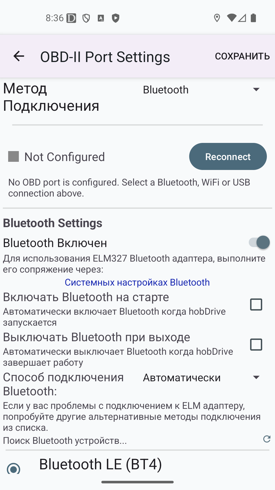{: width="400" }

*Настройки подключения ELM327 на Android (режим Bluetooth).*

Подробнее по качеству и совместимости адаптеров: [Проблемы кривых адаптеров ELM327](bad-elms.md).

### 2. Проверьте статус связи

В индикаторе соединения:

- **Зеленый**: связь с адаптером и автомобилем активна.
- **Желтый**: адаптер найден, отвечает, но есть проблема связи именно с автомобилем.
- **Красный**: проблема связи с адаптером.

Эта индикация полезна для быстрой диагностики: теперь можно отдельно понять, где именно возникла проблема.

### 3. Выберите профиль автомобиля

Откройте: **Настройки -> Параметры автомобиля**.

Рекомендуемый порядок:

1. Попробуйте **Загрузить из шаблона**.
2. Если шаблона нет, настройте профиль вручную.
3. При удачной настройке отправьте профиль через **Поделиться**.

Подробнее: [Готовые профили автомобилей](profiles.md), [Диагностика ABS/SRS и отдельных ЭБУ](custom-ecus.md).

## Основы интерфейса

В приложении есть набор основных экранов и дополнительные экраны.

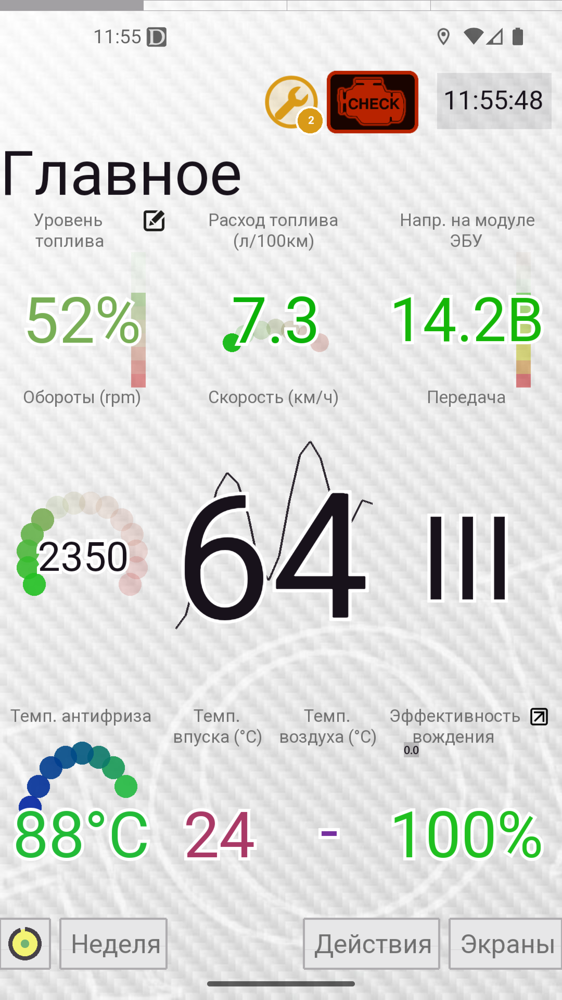{: width="400" }

Навигация выполняется:

- свайпами между экранами,
- через верхнюю полосу быстрой навигации,
- через меню **Экраны**.

Долгое нажатие на сенсор открывает расширенную информацию о его расчете и исходных данных.

Меню «Экраны» открывает доступ к дополнительным элементам управления:

- Временное скрытие приложения (Скрыть)
- Выход из приложения
- Активация вкладки «Настройки»
- Выбор и активация дополнительных экранов

### Центр управления: Единый пульт

В новых версиях доступна дополнительная схема навигации — **Единый пульт**. Круглая кнопка **D** в заголовке открывает панель с подключением, интервалами, группами экранов и частыми действиями. Здесь можно выбрать поездку, открыть журнал, добавить заправку или перейти к графикам и калибровке. Нужную команду можно найти в раскрытом списке **Все**. Классические нижние кнопки **Поездка**, **Действия** и **Экраны** остаются доступными: выключите **Единый пульт** в **Настройки → Настройки интерфейса** и вернитесь к приборам. Далее в руководстве сохранены привычные пути; [отдельная статья о пульте](control-center.md) объясняет новые входы и переключение между схемами.

## Экран «Настройки»

Ключевые разделы:

- Параметры ELM соединения
- Параметры автомобиля
- Системные настройки
- Настройка вида сенсоров
- Сеть / Оформление / Язык / Величины / О программе

<table style="break-inside: avoid;">
<tr><th>Светлая тема</th><th>Тёмная тема</th></tr>
<tr><td>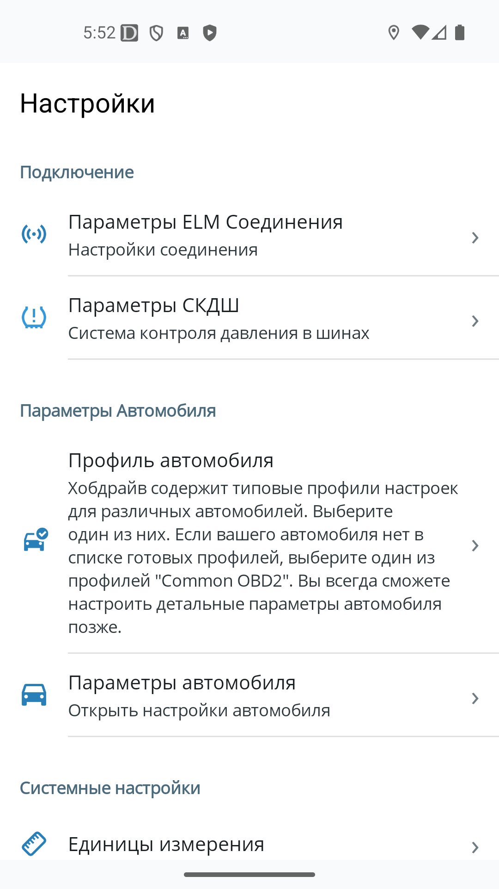</td><td>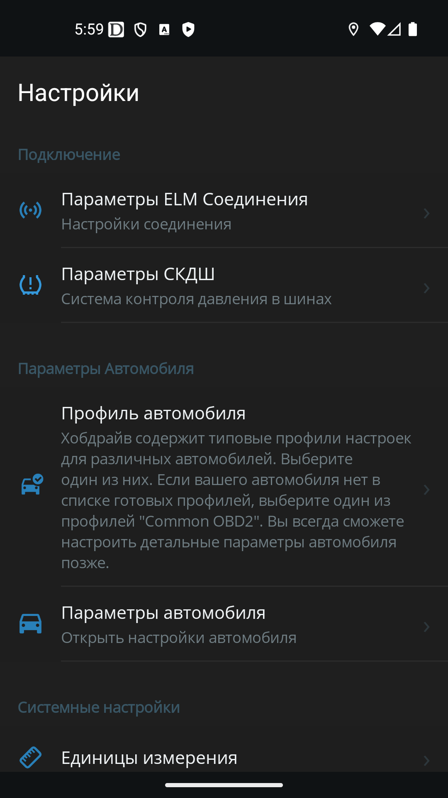</td></tr>
</table>

### Параметры автомобиля

Откройте **Настройки → Параметры автомобиля**, чтобы изменить текущий профиль. Если для вашей модели есть готовый шаблон, сначала откройте соседний пункт **Профиль автомобиля → Создать из шаблона**. Там же можно переключить, скопировать, удалить или отправить профиль. Эти команды находятся в управлении профилями, а не на экране параметров автомобиля.

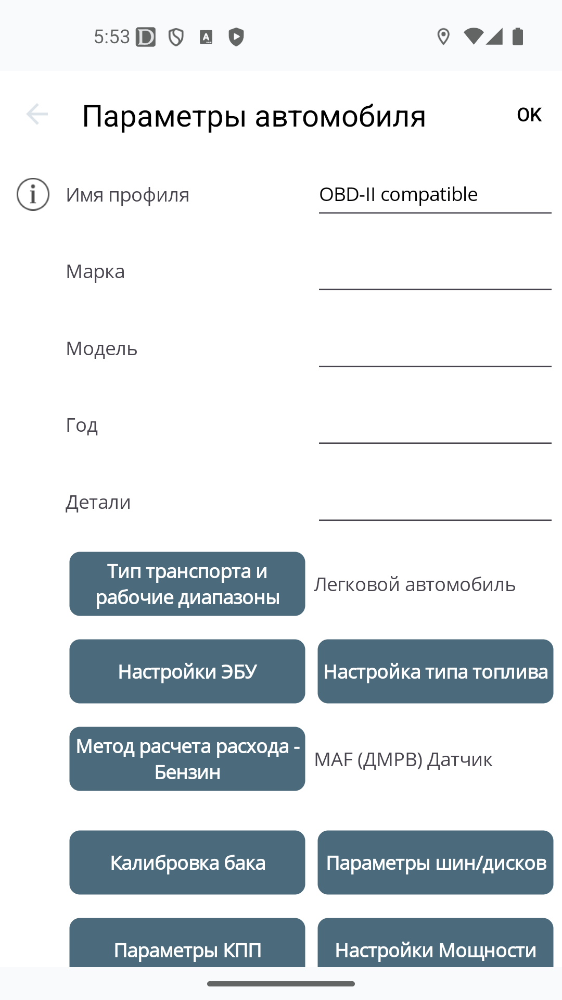{: width="400" }

Подробная статья по профилям и шаблонам: [Готовые профили автомобилей](profiles.md).

**Основной экран профиля.** Поля **Имя профиля**, **Марка**, **Модель**, **Год** и **Детали** описывают автомобиль. Ниже расположены кнопки вложенных настроек и поля **Вес**, **Коэффициент коррекции скорости**, **Коррекция одометра**, **Макс. скорость простоя**, **Темп. прогретого двигателя**, **Интервал для сброса поездки**, **Скорость простоя (мгновенный расход)** и **Сбрасывать мгновенный расход при остановке**. Коррекция скорости влияет также на рассчитываемый пробег; коррекция одометра дополнительно меняет только пробег. Интервал поездки задаётся в секундах: если связь с автомобилем восстановлена до его истечения, авто-поездка продолжается. Два последних параметра управляют расчётом мгновенного и кратковременного расхода при остановках.

**Вложенные экраны:**

- **Тип транспорта и рабочие диапазоны**: отдельно от настроек ЭБУ выбирается легковой автомобиль, грузовик, мотоцикл, квадроцикл / UTV или другой транспорт. Выбор подставляет начальные диапазоны; каждый из них затем можно изменить независимо. Здесь настраиваются напряжение бортовой сети, максимум шкалы оборотов, диапазон расхода топлива, пороги перегрева охлаждающей жидкости, моторного и трансмиссионного масла, предельная коррекция LTFT и нормальный/критический диапазоны давления TPMS. Диапазон TPMS выбирайте по табличке или руководству автомобиля.
- **Настройки ЭБУ**: фильтр производителя ЭБУ, тип ЭБУ (например, стандартный OBD-II или профиль конкретного блока), строка инициализации ELM и доступные дополнительные наборы датчиков. Выбор ЭБУ определяет способ опроса и доступные датчики; фильтр производителя лишь сокращает список. Для обычного OBD-II строку инициализации обычно менять не нужно.
- **Настройка типа топлива**: конфигурация бензин / дизель / газ / бензин+газ / дизель+газ / бензин+электричество / электричество и ёмкость основного бака. Для двухтопливной конфигурации показывается ёмкость второго бака и настройки условия переключения, прежде всего для ГБО: автоматически, по ЭБУ, температуре и оборотам, напряжению либо пользовательскому сигналу. При переходе на двухтопливный учёт приложение предлагает выбрать способ переноса накопленных данных.
- **Метод расчёта расхода**: отдельная форма для основного топлива и, в двухтопливном профиле, для второго. Доступны MAF, MAP, импульс форсунки, цикловой расход, нагрузка двигателя и встроенный датчик расхода. Форма показывает, доступен ли выбранный метод при текущем подключении, текущий расход в час и кнопку **Проверить метод**. Объём двигателя, число цилиндров, AFR, VE, производительность форсунки, коэффициенты расхода и коррекции по отсечке топлива, LTFT и Lambda расположены здесь; применимость отдельных полей зависит от метода. [Методы расчёта и коэффициенты](fuel-methods.md) · [Основные принципы расчёта](fuel-questions.md).
- **Бак и остаток**: ёмкость бака и уже израсходованный из него объём. Для двухтопливного профиля доступны такие же поля второго бака. Этот экран устанавливает исходные данные для оценочного остатка топлива.
- **Параметры шин/дисков**: заводские и установленные размеры диска и шины, переключатель «заводские шины», коэффициент коррекции скорости и кнопка его расчёта по размерам колёс.
- **Параметры КПП**: шаблон и передаточные коэффициенты главной передачи и передач коробки. Они нужны для определения передачи по оборотам и скорости.
- **Настройки мощности**: масса автомобиля, аэродинамическое сопротивление и фронтальная площадь, сопротивление качению, уклон дороги, потери в трансмиссии, максимальная скорость и паспортная мощность; форма показывает расчётную мощность.

Если расход не совпадает с заправками, сначала выровняйте пробег, затем подберите коэффициенты. См. [Разница в показаниях скорости](speed-diff.md).

### Настройки экрана и сенсоров

Актуальные возможности:

- Удобный выбор сенсора с поиском и отображением текущего выбора.
- Настройка количества сенсоров и параметров отображения для экранов.
- Перестановка порядка главных экранов и выбор экранов, которые должны быть всегда активны.
- Настройка индикатора передачи (римские или арабские цифры).
- Параметры видимости даты/времени.

Подробно о порядке экранов, закреплении, скрытии, персональных параметрах и пользовательском экране: [Настройка главных экранов](screen-settings.md).

### Оформление

Поддерживаются:

- светлые и темные темы,
- несколько фоновых изображений в одной теме,
- расширенные параметры читаемости (например, контуры текста/значений с возможностью отключения).

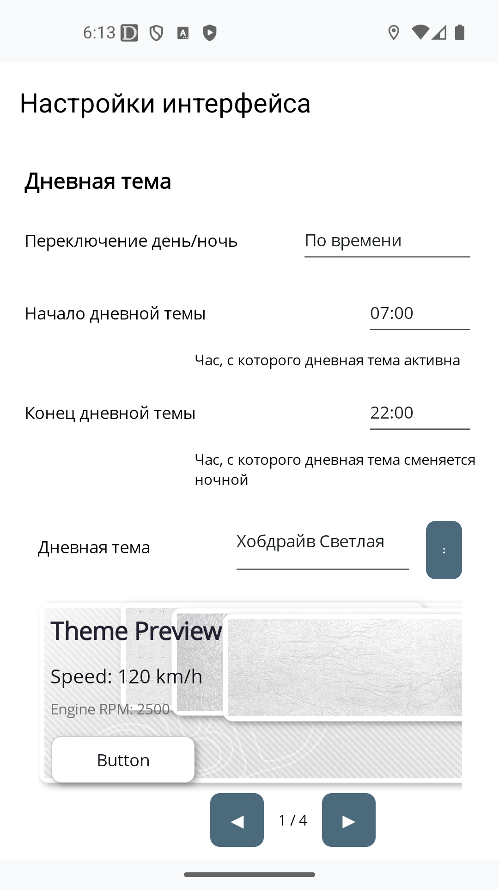{: width="400" }

## Основные и дополнительные экраны

### Основные показания

Экран текущего состояния автомобиля в движении. Все датчики (сенсоры) считываются последовательно, скорость обновления может зависеть от производительности ELM-адаптера и устройства. Задержка в чтении показаний может достигать 1-2 секунд.

{: width="400" }

**Основные сенсоры:**

- **Скорость**: Скорость из настроенного источника, обычно ЭБУ. Она может отличаться от спидометра и GPS. Поправки скорости и пройденного расстояния различаются: см. [скорость и пробег](speed-diff.md).
- **Ускорение**: Мгновенное ускорение в метрах на секунду в квадрате, показывает интенсивность разгона или замедления.
- **Обороты**: Текущие обороты двигателя (RPM).
- **Уровень топлива**: Оценочный уровень топлива в баке. Требует начальной калибровки (см. экран «Детали топлива»).
- **Расход топлива**: Топливная экономичность в литрах на 100км за текущую поездку. Основной параметр эффективности автомобиля.
- **Напряжение**: Напряжение в бортовой сети автомобиля. Может использоваться для оценки работы генератора или уровня разрядки аккумулятора.
- **Температура антифриза**: Текущая температура антифриза (и двигателя). Основной параметр для оценки степени прогретости двигателя.
- **Температура впуска**: Температура воздуха на впуске в камеры сгорания. Обычно близка к температуре окружающего воздуха.
- **Температура воздуха**: Температура окружающей среды. Может быть недоступна на некоторых автомобилях.

Значения всех датчиков передаются ECU автомобиля и могут не совпадать с реальными показаниями. Различные датчики имеют разный период обновления. На датчиках с фоновым графиком можно видеть текущие минимальное и максимальное достигнутые значения.

**Управление через панель статуса:**

Нажав на всплывающую панель статуса (круг слева внизу), вы увидите:

- Детальный статус OBD2 и GPS соединений.
- Кнопку «Переподключиться» — для принудительной попытки подключения.
- Опцию «Режим быстрого чтения» — отключает вычисление расчетных данных и фокусируется на скорости опроса видимых данных, используется для диагностики.

### Бортовой компьютер

Экран описывает основные показатели текущей поездки либо выбранного интервала времени. Позволяет оценить как совокупную эффективность и стоимость пробега, так и мгновенные показатели расхода.

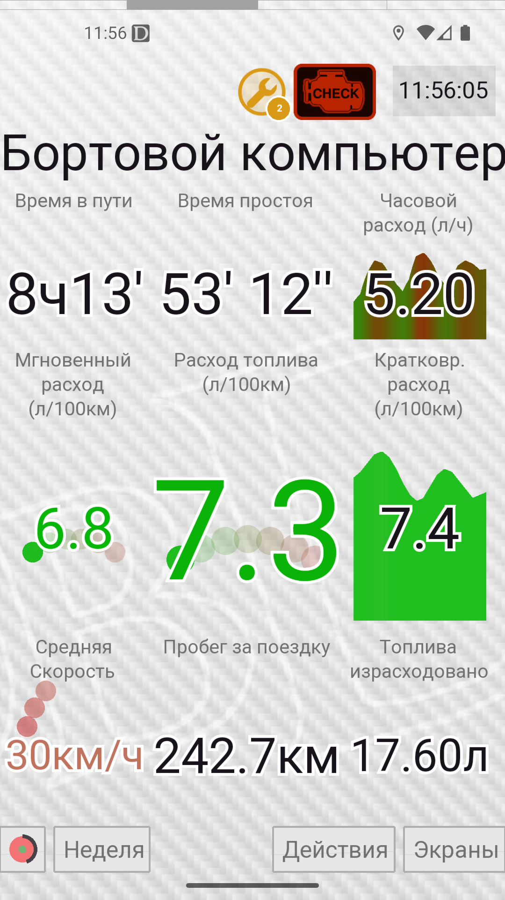{: width="400" }

**Основные метрики:**

- **Время в пути**: Время проведенное в автомобиле с включенным зажиганием.
- **Время простоя**: Время стояния в пробках, на светофорах с работающим двигателем. Простоем считается движение с очень маленькой скоростью (значение по умолчанию — 5 км/ч).
- **Топлива в час**: Мгновенный расход топлива в единицу времени в литрах. Обычные показания для холостого хода — от 0.5 до 1.5 литров в час. Позволяет контролировать режим работы двигателя и влияние дополнительных источников нагрузки (например, кондиционер).
- **Мгновенный расход**: Топливная экономичность (в литрах на 100км) за последние несколько секунд. Позволяет оценить экономичность в динамике.
- **Расход топлива**: Общий расход за поездку (выбранный интервал времени) в литрах на 100км. Основной параметр оценки совокупной эффективности.
- **Кратковременный расход**: Топливная экономичность за последние несколько минут. Позволяет проследить эффективность движения в краткосрочном интервале.
- **Пробег за поездку**: Общий пробег за поездку. См. раздел калибровки для выравнивания с приборной панелью.
- **Топлива израсходовано**: Общее количество топлива в литрах за поездку.

**Выбор интервала времени:**

При нажатии на кнопку «Поездка» HobDrive отобразит доступные отслеживаемые интервалы времени. При смене активного интервала все данные на экранах изменятся.

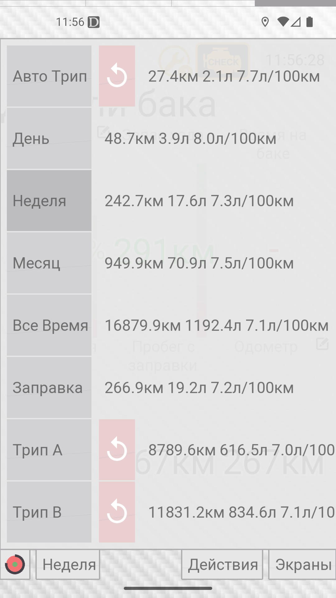{: width="400" }

- **Авто Трип**: Текущая поездка. Определяется автоматически как только интервал между включениями зажигания превысит предустановленное значение (10мин. по умолчанию).
- **День**: Накопленные показания за сегодняшний день. Сбрасываются в полночь.
- **Неделя**: Накопленные показания за неделю. Сбрасываются в полночь каждого воскресенья.
- **Месяц**: Накопленные показания за месяц.
- **Все время**: Накопленные показания за все время работы HobDrive.
- **Заправка**: Накопленные показания за текущую заправку. HobDrive сбрасывает интервал при вводе новой записи о заправке.
- **Трип А, Трип Б**: Накопленные показания для двух поездок, управляемых и сбрасываемых по вашему желанию.

Вручную можно сбрасывать накопленные показания для «Авто поездки» и для поездок «Трип А, Б».

### Детали расхода

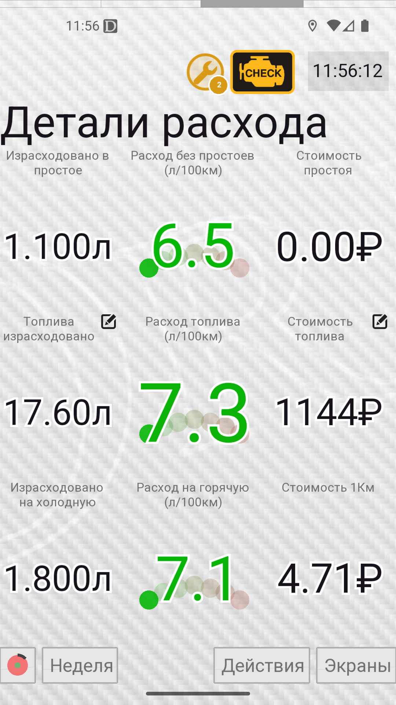{: width="400" }

Экран показывает детальную информацию по расходу топлива:

- Расход топлива в простоях (пробках, светофорах),
- Топливная экономичность без учета простоев,
- Сумма, потраченная на простой в пробках,
- Сумма, потраченная на текущую поездку,
- Количество топлива, израсходованного на прогрев двигателя (до температуры 60°C),
- Расход топлива только на прогретом двигателе,
- Стоимость топлива на 1 километр пробега.

Сенсоры с зеленым индикатором означают возможность дополнительной настройки. При нажатии на показания стоимости откроется экран с настройкой текущей стоимости литра топлива и используемой валюты.

### Детали топлива

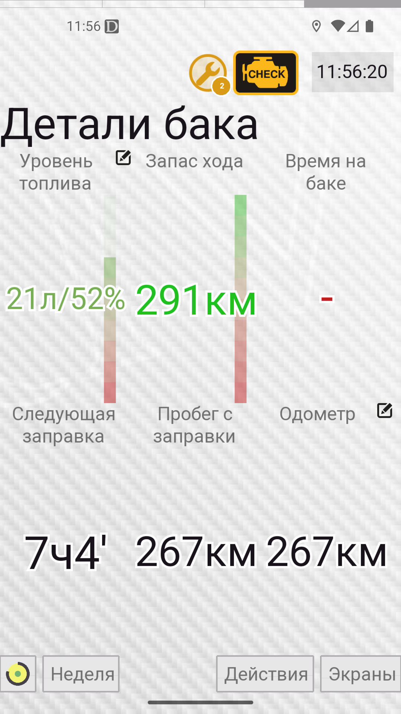{: width="400" }

Экран показывает детальную информацию по уровню топлива и калибровке бака.

Текущий **оценочный уровень топлива** и **оценочное количество топлива** в баке вычисляются на основе информации о введенных заправках и показаниях расхода.

При нажатии на один из сенсоров уровня топлива откроется диалог калибровки топливного бака. При первом использовании необходимо ввести объем вашего бака и примерное количество уже потраченного топлива.

Затем HobDrive сам уменьшает расчетное количество топлива в баке. Для поддержания его в актуальном состоянии необходимо вести записи о заправках.

Дополнительно на экране рассчитываются:

- **Пробег на остатке** топлива в баке,
- **Время непрерывного движения** на остатке,
- **Следующая заправка** — примерное время следующей заправки на основе средненедельных трат,
- **Максимальные температура и скорость** — значение максимальной наблюдаемой величины,
- **Средняя скорость** — вычисляется за текущий выбранный интервал времени с учетом всех простоев.

Некоторые машины передают от ЭБУ реальный показатель уровня топлива (сенсор **ECUFuelLevel**). В HobDrive этот показатель перекрывается расчетным, основанным на введенных данных и расходе.

### Пробеги и расходы

Текущий пробег и расход смотрите на приборных экранах с выбранным интервалом, прошлые поездки — в **Статистика и события → Статистика**, а фактические затраты — в журналах **Заправки** и **События**. В Едином пульте эти разделы доступны в группе **Статистика**. Расчётная стоимость поездки зависит от цены топлива; суммы в журнале отражают введённые расходы. Для графиков затрат по времени, структуры расходов и сравнения поездок доступен онлайн-отчёт. Порядок работы и различия между источниками: [Пробеги и расходы](trips-and-expenses.md); настройка облачного отчёта: [Статистика поездок и онлайн-аналитика](statistics.md).

### Заправки и события

Журналы показывают записи компактными карточками с поиском по всей истории, фильтрами, сортировкой и страницами по 10, 25 или 50 записей. В **Действиях** выберите **Новая заправка** или **Новая запись**; добавить запись можно и из самого журнала. Для заправок сохраняйте объём, сумму, одометр и отметку полного бака, для обслуживания — работу, стоимость и заметки. В карточке заправки видны три показателя расхода: **Бак**, **Последние 3**, **Накопленный**. Итоги разделены по текущей странице, выбранным записям и всей истории; валюты учитываются отдельно. Изменение, удаление, карты и ввод пропущенной поездки описаны в статье [Пробеги и расходы](trips-and-expenses.md).

### Напоминания о сервисе

Отдельный экран **«Напоминания о сервисе»** контролирует обслуживание по дате, одометру или обоим условиям. Можно начать с шаблонов или создать свои интервалы, записать выполненную работу, отложить или пропустить цикл и получать локальные уведомления о наступившем сроке.

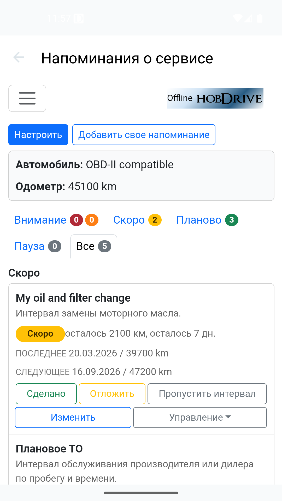{: width="400" }

Пошаговая инструкция: [Сервисные интервалы и напоминания](service-reminders.md).

### GPS и движение

На GPS-экране доступны графики и улучшенное отображение направления движения.

**Экран Ускорения**: Отдельный экран данных ускорения с анализом данных G-сенсора устройства и определением направления.

**Экран Мощности**: Улучшен рассчет на основе актуальных параметров.

### Моточасы

Экран EngineHours показывает суммарное время работы двигателя и полезен для планирования обслуживания (каждые N моточасов).

### Диагностика и дополнительные экраны

Помимо основных экранов, HobDrive предоставляет расширенную диагностическую информацию.

**Экран Диагностика**: Экран для диагностики различных предупреждений, ошибок двигателя и их описаний.

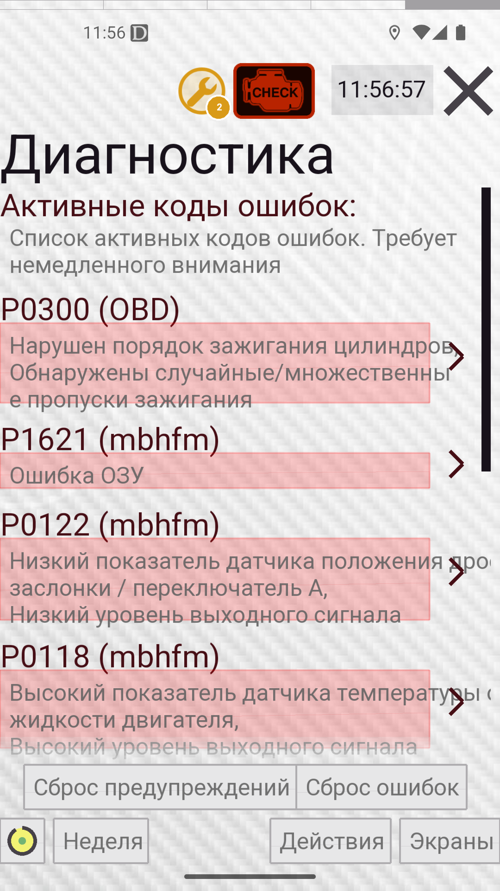{: width="400" }

Кнопка **Мониторинг** внизу экрана открывает правила, активные предупреждения и историю. Подробнее в разделе [Мониторинг автомобиля](monitoring.md).

При активации происходит считывание кодов неисправностей:

- **Активные коды**: требуют немедленного внимания и диагностики.
- **Ожидаемые коды**: потенциальные ошибки в будущем.

Кнопка «Сброс ошибок» позволяет сбросить коды если то необходимо. _Внимание_: сброс не решает саму проблему. Коды freeze-frame могут быть полезны для диагностики в сервисе.

### Графики датчиков

Откройте **Экраны → Графики** или действие **Графики** в Едином пульте, чтобы сравнивать несколько датчиков на общей временной оси. Можно выбрать готовый набор или создать свой, поставить просмотр на паузу, изменить масштаб и открыть записанную историю. В полной версии доступны диагностические сессии с метками; в запись включается доступный фрагмент текущего набора до нажатия кнопки. **Режим быстрого чтения** временно приостанавливает обычный расчёт пробега, расхода и трек-запись, поэтому для повседневного учёта его лучше выключать. Пошаговое описание: [Графики датчиков](charts.md).

### Мониторинг автомобиля

Мониторинг проверяет показания по правилам, сообщает о подтверждённых нарушениях и сохраняет события в истории выбранного автомобиля. Откройте **Диагностика → Мониторинг** или одноимённый пункт настроек: здесь находятся **Правила**, **Активные** предупреждения и **История**. Можно включить готовую проверку или создать свою, задать пороги, выдержку и условия, например для города, зимы или полной загрузки. Проверки работают, пока hobDrive получает нужные данные. Подробно: [Мониторинг автомобиля](monitoring.md).

## Настройка внешнего вида сенсоров

Активация режима настройки происходит через «Экраны → Настройки → Настройка вида сенсоров».

При активации этого режима нажатие на любом сенсоре на любом экране открывает диалог конфигурации.

В диалоге настраиваются:

- тип виджета (текстовый, линейный индикатор, круговой индикатор, график),
- диапазон типирования,
- должные цвета,
- другие визуальные параметры.

Каждый из параметров имеет описание (вы можете нажать на юточку при длительном нажатии).

Расширенная настройка через файлы раскладок: [Оформление, экраны и DashKits](layouts.md), [Спецификация языка разметки](LAYOUT_SPEC_RU.md), [Динамические выражения](dynamic-expr.md).

**Экран Топливные коррекции**:

Топливные коррекции STFT (краткосрочная) и LTFT (долгосрочная) — это параметры ЭБУ, определяющие эффективность автомобиля в использовании топливно-воздушной смеси.

На старых или загрязненных двигателях их абсолютная величина может достигать больших значений (20% и больше) и может спровоцировать коды ошибок. Топливные коррекции в пределах нескольких процентов означают нормальную работу двигателя.

**Экран Лямбда датчики**:

Показывает показания датчиков кислорода (не все четыре могут присутствовать данрава в зависимости от автомобиля).

**Экран Еще сенсоры, сенсоры Toyota, список сенсоров**:

Дополнительные сенсоры, в основном интересные для профессиональной диагностики.

Экран со списком всех датчиков позволяет выбрать любой и начать чтение его значения.

## HUD режим

HUD скрывает лишние элементы интерфейса и подготавливает изображение для проекции на стекло. Используйте в первую очередь как вспомогательный режим, не отвлекающий от дороги.

## Управление данными, резервные копии и облако

В диалоге **Управление данными** доступны:

- создание резервной копии,
- восстановление,
- фоновая выгрузка в облако,
- настройка периодичности выгрузки,
- удаление старых данных.

Рекомендация: включите регулярный бэкап, особенно перед сменой устройства или перед тестированием новых DashKits.

Подробно о файлах, переносе и восстановлении: [Как перенести настройки или сделать бэкап](backups.md).

Настройка, сравнительный анализ и графики заправок/расходов: [Статистика поездок и онлайн-аналитика](statistics.md).

## DashKits, темы и расширяемость

HobDrive поддерживает настройку внешнего вида и логики экранов через DashKits.

Что можно делать:

- подключать готовые панели и темы,
- выбирать скины в диалоге DashKits,
- использовать несколько изолированных наборов пользовательских переопределений,
- добавлять собственные экраны и оформление под конкретный сценарий.

Для опытных пользователей доступны дополнительные возможности раскладок: условный вывод (`if`), фильтры сенсоров, управление видимостью элементов, графические декораторы, параметры стадий отрисовки.

Подробные материалы для продвинутой кастомизации:

- [Оформление, экраны и DashKits](layouts.md)
- [Спецификация языка разметки HobDrive](LAYOUT_SPEC_RU.md)
- [Динамические выражения в файлах настроек](dynamic-expr.md)
- [Динамические выражения: базовый синтаксис](dynamic-expr-core.md)
- [Спецификация формата ECUXML](ecuxml_spec.md)

## Android: виджеты

В Android поддерживаются виджеты, которые отображаются в стиле приложения и настраиваются под нужные сенсоры/параметры. Это удобно для быстрого просмотра ключевых данных без открытия приложения.

Как добавить, настроить, изменить размер и устранить проблемы: [Виджеты HobDrive для Android](android-widgets.md).

## iOS и CarPlay

iOS находится в полноценном рабочем контуре HobDrive:

- поддержка Wi-Fi и Bluetooth LE адаптеров,
- улучшения стабильности подключения,
- обновленные экраны и обработка системных сценариев,
- поддержка дублирующего экрана в CarPlay.

Рекомендация для iOS: после обновлений системы проверяйте повторно разрешения Bluetooth/геолокации и доступность адаптера в системных настройках.

Пошаговая инструкция для автозапуска на CarPlay: [Автоматический запуск через Shortcuts](carplay-shortcut.md).

## Калибровка и точность расчетов

Экран **Действия → Калибровка расхода** (в Едином пульте — **Калибровка**) позволяет отдельно подобрать поправки пробега и топлива. Сначала сравните расстояние hobDrive с одометром автомобиля или независимым измерением за тот же участок. Затем проверьте топливо: по среднему расходу либо по объёмам за одинаковые интервалы между полными баками. До применения видны новый коэффициент и ожидаемое изменение; последние поправки сохраняются в истории. Изменения действуют на будущие измерения и не пересчитывают накопленные данные. **Бак и остаток** отдельно задаёт исходный остаток топлива.

Пошаговое описание со скриншотами: [Калибровка пробега и расхода](calibration.md). Формулы и особенности методов: [Методы расчета расхода](fuel-methods.md), [Скорость и пробег](speed-diff.md), [Основные принципы расчёта топлива](fuel-questions.md). В форме быстрой калибровки принимаются точка и запятая; в остальных старых формах параметров используйте точку.

## Типичные проблемы

### Нет подключения к машине

- Проверьте, что адаптер виден в системе и выбран верный тип подключения.
- Посмотрите цвет статуса: красный (адаптер) или желтый (авто).
- Для нестабильных адаптеров увеличьте задержку общения с ELM.

Детальный разбор некачественных адаптеров: [Проблемы кривых адаптеров ELM327](bad-elms.md).

### Неверный расход/пробег

- Проверьте метод расчета топлива.
- Проверьте коэффициенты скорости и одометра.
- Сверьте статистику с фактическими заправками.

Подробнее: [Методы расчета расхода](fuel-methods.md), [Расход топлива: вопросы и ответы](fuel-questions.md), [Разница в показаниях скорости](speed-diff.md).

### После обновления «поехал» интерфейс

- Проверьте выбранные тему/скин/DashKit.
- Отключите проблемный кастомный набор и проверьте поведение на стандартной теме.

Если проблема воспроизводится, отправьте отчет: [Отчет о проблеме, сбое](problems.md).

## Раздел для будущих расширений

Этот раздел зарезервирован для развития руководства. Рекомендуемые будущие главы:

- Подробный гайд по созданию собственного DashKit с примерами.
- Каталог рекомендуемых пользовательских экранов по сценариям (город, трасса, диагностика).
- Отдельные best practices для CarPlay.

## Важное предупреждение по безопасности

Автомобиль является источником повышенной опасности. Не настраивайте сложные параметры и не анализируйте детально экраны во время движения. Выполняйте настройку на стоянке.
